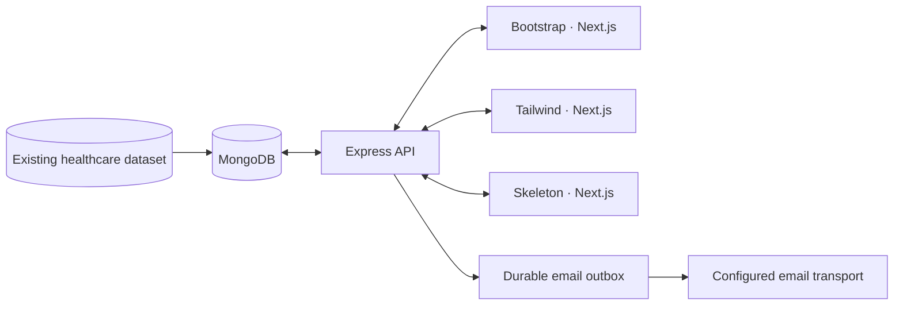

<div align="center">


# Connected healthcare for Mumbai

Find a provider. Start the right request. Follow what happens next.

[](https://github.com/kasim672/medreach/actions/workflows/ci.yml)
[](https://github.com/kasim672/medreach/actions/workflows/evaluate.yml)

[Explore the app](https://medreachmumbai.vercel.app/) · [Documentation](docs/README.md) · [Screenshots](docs/screenshots/README.md) · [Run locally](#run-locally)

</div>


MedReach brings hospital, blood-bank, diagnostic and ambulance discovery into
one application, with provider onboarding, healthcare requests and Careers.
Three independent Next.js frontends—**Bootstrap, Tailwind and Skeleton**—use
the same Express API, MongoDB dataset and backend access controls.

Screenshots show the actual local application and stored directory records,
captured on **22 October 2026**. They are interface snapshots, not evidence of
current availability, campaign dates, provider participation or live dispatch.

## Table of Contents

- [Explore MedReach](#explore-medreach)
  - [Feature Highlights](#explore-medreach)
  - [Visual Tour](#a-closer-look)
- [Three Frontends, One Product](#three-frontends-one-product)
- [Roles and Access](#roles-and-access)
- [Run Locally](#run-locally)
- [Architecture & Diagrams](#architecture)
- [Verification & Quality Checks](#verification)
- [Documentation Hub](#documentation)
- [Troubleshooting](#troubleshooting)
- [Data and Contribution Boundaries](#data-and-contribution-boundaries)
- [License](#license)

## Explore MedReach

| Find care | Coordinate and follow up | Manage the network |
| --- | --- | --- |
| Hospitals and provider profiles | Standard and emergency bed requests | Provider applications and approvals |
| Blood banks and diagnostics | Normal/urgent blood requests and blood donation | Organisation-scoped Provider Admin workspace |
| Ambulance listings and map discovery | Ambulance requests and private request history | System Admin accounts and platform oversight |
| Directory-grounded assistant | Healthcare Careers, applications and reference tracking | Eligible provider/user email notifications |

Requests support coordination. They do not guarantee a bed, blood inventory,
an appointment or ambulance dispatch. The app is not a medical advice service.

### A closer look

| Hospital discovery | Provider onboarding |
| --- | --- |
|  |  |
| Search actual stored listings and open provider details. | Apply from the homepage; review and activation precede access. |

| Healthcare Careers | Hospital details |
| --- | --- |
|  |  |
| Browse organisations and their available application flows. | Review recorded information before contacting the provider. |

See the [full screenshot gallery](docs/screenshots/README.md) for mobile views,
emergency discovery and all three frontend variants.

## Three frontends, one product

| Bootstrap | Tailwind | Skeleton |
| --- | --- | --- |
|  |  |  |
| Bootstrap 5.3 · port `3000` | Tailwind CSS 4 · port `3001` | Skeleton CSS 2 · port `3002` |

Each variant keeps its own components and framework styling. Shared workflows
use the same API and data semantics. Some UI is deliberately variant-specific,
including Bootstrap's local manual credential handover. See
[parity scope](docs/PARITY_VERIFICATION.md) for the exact boundaries.

## Roles and access

One login page routes accounts to the appropriate workspace.

| Role | Workspace | Access |
| --- | --- | --- |
| `system_admin` | `/admin` | Platform oversight, provider approvals/accounts, users and emergencies |
| `provider_admin` | `/provider` | Explicitly assigned organisations and their permitted workflows |
| `user` | `/dashboard` | Own profile, requests, blood donation and applications |

Public registration creates regular users. A provider application grants no
login access before approval and activation. Backend checks enforce role and
organisation scope, including direct API calls. Historical role values do not
create new account options. [Security and account lifecycle →](docs/security.md)

## Run locally

**Requirements:** Node.js **≥22.19.0**, npm, and MongoDB with the intended dataset.
CI uses Node.js 24. Install dependencies from the repository root.

```sh
npm ci
./run.sh
```

| Service | URL |
| --- | --- |
| Shared API | <http://localhost:4000> |
| Bootstrap | <http://localhost:3000> |
| Tailwind | <http://localhost:3001> |
| Skeleton | <http://localhost:3002> |

To run one frontend with the backend, use `./run.sh bootstrap`,
`./run.sh tailwind` or `./run.sh skeleton`. Press `Ctrl+C` to stop the launcher.

<details>
<summary><strong>First setup and environment variables</strong></summary>

Keep existing environment files. On a new machine, use the supplied
`.env.example` files as templates and configure the intended MongoDB connection.
`MONGODB_URI` takes precedence over `MONGO_URI`.

Set `NEXT_PUBLIC_API_URL` before production frontend builds. Maps uses a
restricted browser API key when configured; without a usable key, provider
lists remain available with an honest map fallback. Email and optional external
AI configuration belong on the backend. Never expose their secrets through
`NEXT_PUBLIC_*`.

The recovered workstation dataset is at `/home/anonymous/medreach/data`.
Do not seed, reset or run browser fixtures against it. New installations do not
receive a copy of that private database from Git.

[Local MongoDB setup](LOCAL_MONGODB_SETUP.md) · [Deployment and email](docs/deployment.md)

</details>

## Architecture



The selected hosting stack is **Vercel → Railway → MongoDB Atlas**. The API
process owns expiry, recovery and email workers. MedReach does not crawl
provider websites; historical acquisition provenance stays in the stored dataset.

```text
backend/          Express routes, permissions, models, services and workers
packages/core/    Shared frontend client, hooks and data helpers
variants/         Independent Bootstrap, Tailwind and Skeleton frontends
tests/            Browser journeys and focused unit tests
docs/             Architecture, operations, security and verification guides
evaluation/       Research tooling and explicitly limited measurements
user-study/       Proposed protocols and draft questionnaires
```

[Architecture and code map →](docs/architecture.md) · [Complete Diagrams Gallery →](docs/diagrams/README.md)

| System Topology | Database ER Schema | Cloud Deployment |
| :---: | :---: | :---: |
| [](docs/diagrams/README.md#1-system-architecture) | [](docs/diagrams/README.md#2-database-entity-relationship-er-diagram) | [](docs/diagrams/README.md#6-deployment-architecture) |
| Multi-tier Express/Next.js layers | 16 collections & relationships | Vercel, Railway & Atlas topology |

Additional lifecycle diagrams:
[Role Matrix](docs/diagrams/README.md#3-role-permission-matrix) · [Provider Onboarding](docs/diagrams/README.md#4-provider-onboarding-sequence) · [Request & Notification Flow](docs/diagrams/README.md#5-request-lifecycle--notification-flow) · [Authentication Flow](docs/diagrams/README.md#7-authentication--role-redirection-flow)

## Verification

Latest completed code baseline: [`1f870b4`](https://github.com/kasim672/medreach/commit/1f870b401f63ac5612217a1626259acfd278b913).
[All 13 GitHub checks passed](https://github.com/kasim672/medreach/actions/runs/39489882190).

| Check | Recorded result |
| --- | --- |
| Backend, all database gates | **352 passed**, no failures or skips |
| Focused unit tests | **15 passed** |
| Browser journeys | **269 passed**, 40 explicit Bootstrap-only scope skips |
| Production builds | **Bootstrap, Tailwind and Skeleton passed** |
| Dependency audit | **0 known vulnerabilities** at the recorded check |
| Lint | **0 errors**, 12 existing hook dependency warnings |
| Disposable backup/restore drill | **16 collections / 539 test documents restored** |

These are dated regression results. They do not certify security, clinical
accuracy, accessibility compliance, real inbox receipt or hosted performance.
The workflow badges above show subsequent GitHub status.

```sh
npm run lint
node --test tests/unit/*.test.mjs
npm run backend:test:db
npm run build:variants
npm run test:e2e
git diff --check
```

**Use disposable databases for tests.** Backend/browser fixtures can delete
their own data. Plain `npm test` may skip database-gated suites; the strict
runner enables all gates. [Safe setup, full release check and evidence →](docs/release-qa.md)

## Documentation

Start with the [documentation hub](docs/README.md), organised by task.

| Build and understand | Run and maintain | Product and research |
| --- | --- | --- |
| [Architecture](docs/architecture.md) · [Diagrams](docs/diagrams/README.md) | [Deployment and email](docs/deployment.md) | [Services and maps](docs/SERVICES_AND_MAP_GUIDE.md) |
| [API reference](docs/api.md) | [Release QA](docs/release-qa.md) · [Testing](docs/testing.md) | [Request lifecycle](docs/bed-request-lifecycle.md) |
| [Data model](docs/data-model.md) · [Database schema](docs/database-schema.md) | [Security](docs/security.md) · [Privacy](docs/privacy.md) | [Assistant](docs/ai-assistant.md) |
| [Frontend variants](variants/README.md) | [Performance measurements](docs/latency-verification.md) | [Evaluation tooling](evaluation/README.md) |

## Troubleshooting

| Symptom | Cause | Solution |
| --- | --- | --- |
| `EADDRINUSE: address already in use :::3000` (or `4000`) | A prior process is holding the frontend or backend port. | Find and terminate the process: `lsof -ti :3000 | xargs kill -9` (or replace with `3001`, `3002`, `4000`). |
| `MongooseServerSelectionError: connect ECONNREFUSED 127.0.0.1:27017` | Local MongoDB daemon is not running. | Start MongoDB daemon: `mongod --dbpath /path/to/db` or verify status with `mongosh --eval "db.adminCommand('ping')"`. |
| API returns `401 Unauthorized` on `/api/auth/me` | Refresh token expired, revoked, or cookies blocked. | Log in again at `/login`. Verify browser accepts `SameSite=Lax` / `Secure` cookies. |
| Stale styles or missing client modules after branch switch | Next.js build cache discrepancy. | Clear `.next` build caches across variants: `rm -rf variants/*/.next`. |
| Map fails to load or shows grey container | Missing or restricted Google Maps API key. | MedReach provides an honest list fallback without an active key. Supply `NEXT_PUBLIC_GOOGLE_MAPS_API_KEY` in `.env.local` if map rendering is required. |

### Data and contribution boundaries

Keep credentials, patient information, private tracking links, resumes and database
files out of Git and screenshots. Preserve real provider data and assignments.
Use isolated fixtures for repeatable workflows. Never add fake availability to
make a page look populated. See [stored data](docs/stored-data.md) and
[local provider accounts](LOCAL_PROVIDER_ACCOUNTS.md).

The crawler, Google OAuth, in-app notification inbox, User Admin role and
`/admin/operations` are intentionally retired. Maps, provider approvals, email
and the main `/admin` dashboard remain.

Research plans, draft study instruments and historical figures are labelled in
the [research documentation](evaluation/README.md). Placeholder scores are not
empirical results or security certifications.

## License

This project is licensed under the [MIT License](package.json).

---

Designed and engineered for Mumbai's connected healthcare ecosystem.
