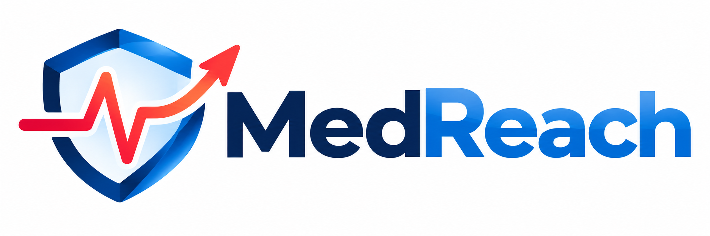
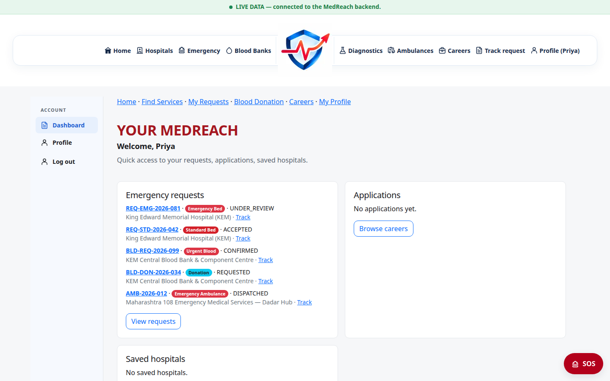
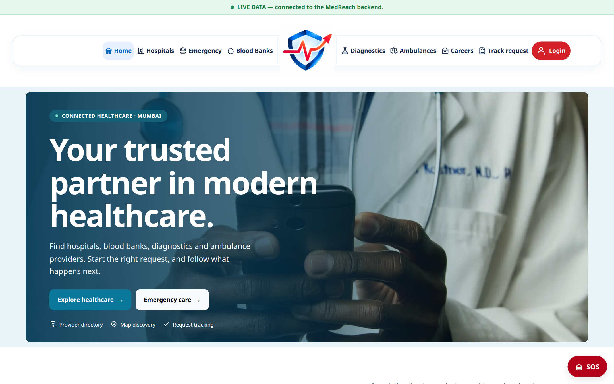
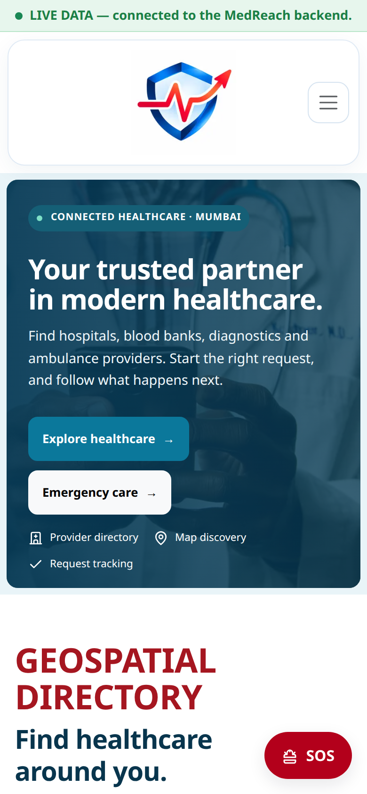
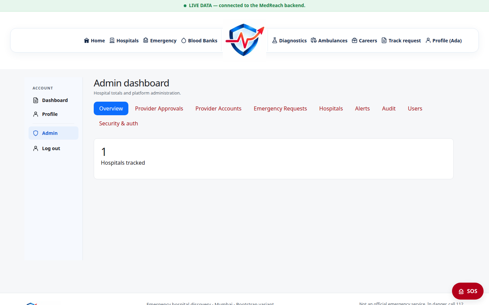
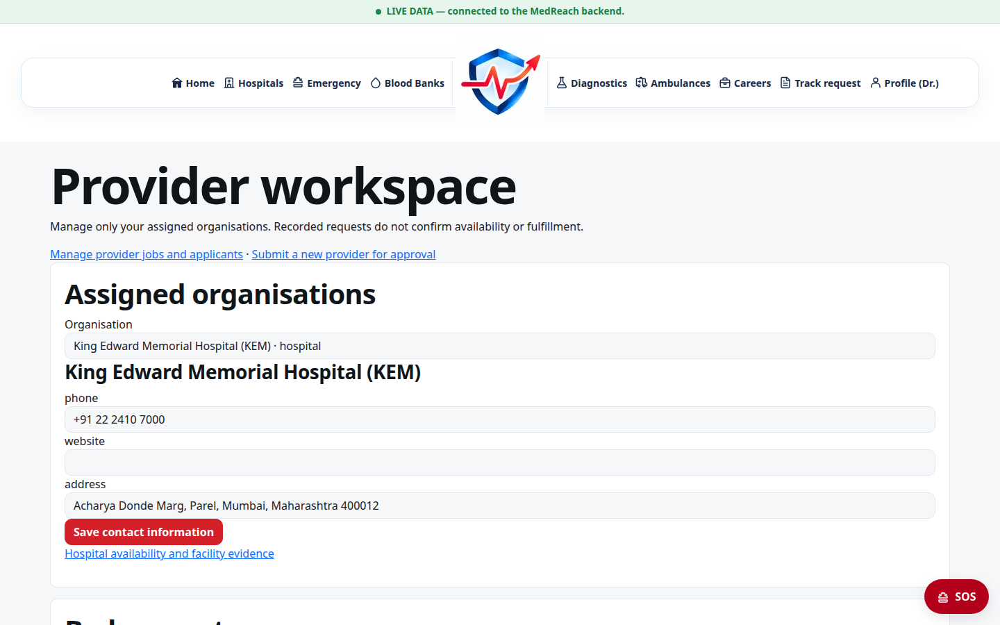
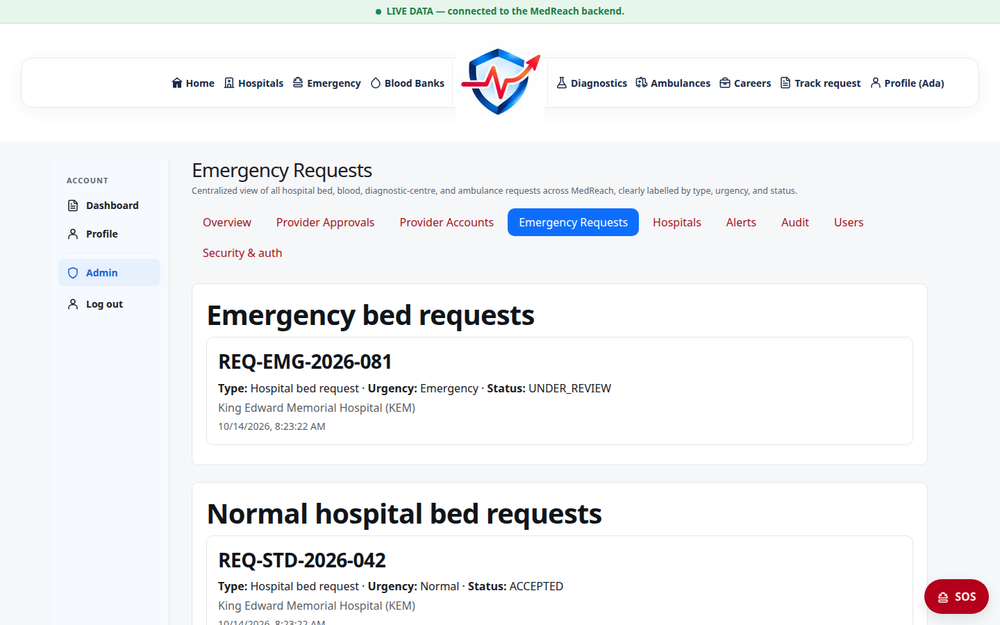
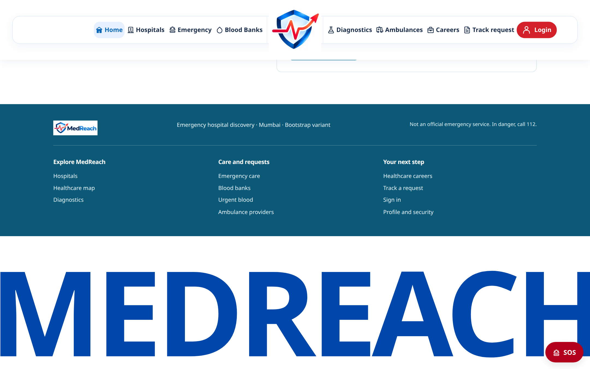

<p align="center">
  
</p>

<h1 align="center">MedReach</h1>

<p align="center">
  <strong>Mission-Critical Healthcare Discovery, Emergency Bed Triage & Multi-Tenant Provider Coordination Platform</strong>
</p>

<p align="center">
  <a href="https://nodejs.org/"></a>
  <a href="https://nextjs.org/"></a>
  <a href="https://expressjs.com/"></a>
  <a href="https://www.mongodb.com/"></a>
  <a href="https://playwright.dev/"></a>
  <a href="docs/testing.md"></a>
  <a href="LICENSE"></a>
</p>

<p align="center">
  
</p>

---

## Table of Contents

1. [Executive Overview & Purpose](#1-executive-overview--purpose)
2. [Healthcare Use Cases & Core Features](#2-healthcare-use-cases--core-features)
3. [The Three Frontend Variants](#3-the-three-frontend-variants)
4. [Role-Based Access Control (RBAC)](#4-role-based-access-control-rbac)
5. [Visual Feature Gallery & Screenshots](#5-visual-feature-gallery--screenshots)
6. [System Architecture & Data Topology](#6-system-architecture--data-topology)
7. [Provider Onboarding & Approval Workflow](#7-provider-onboarding--approval-workflow)
8. [Healthcare Requests & Notification Workflows](#8-healthcare-requests--notification-workflows)
9. [Local Development & Setup Guide](#9-local-development--setup-guide)
10. [Configuration & Environment Variables](#10-configuration--environment-variables)
11. [REST API & Database Schema Overview](#11-rest-api--database-schema-overview)
12. [Authentication & Security Architecture](#12-authentication--security-architecture)
13. [Testing Suite & Verified Evidence](#13-testing-suite--verified-evidence)
14. [Deployment Topologies](#14-deployment-topologies)
15. [Troubleshooting & Diagnostics](#15-troubleshooting--diagnostics)
16. [Known Limitations & Future Roadmap](#16-known-limitations--future-roadmap)
17. [Contributing & Code Standards](#17-contributing--code-standards)
18. [License & Acknowledgments](#18-license--acknowledgments)
19. [Documentation Index](#19-documentation-index)

---

## 1. Executive Overview & Purpose

**MedReach** is a production-grade emergency healthcare coordination engine engineered for metropolitan healthcare networks (currently centered on Mumbai). Built to solve the critical latency and opacity barrier during acute medical emergencies, MedReach connects citizens, paramedics, hospital administrators, blood banks, and ambulance fleets into a unified real-time triage ecosystem.

### Architectural Philosophy: Deterministic Healthcare Integrity
In healthcare coordination, inaccurate information is worse than missing information. MedReach enforces three core operational guarantees:
1. **No Runtime Hallucinations or Scraping:** Healthcare facilities, specialties, and contact records are served from a deterministic, verified MongoDB database. The platform executes **zero** runtime web crawlers or scrapers.
2. **Honest Unknowns:** If real-time ICU or bed census data has not been attested by staff within freshness windows, MedReach marks the status as `Unknown` rather than fabricating estimates.
3. **Coordination ≠ Unilateral Confirmation:** Submitting a request records a cryptographically tracked coordination requisition; acceptance requires explicit medical staff review.

---

## 2. Healthcare Use Cases & Core Features

```text
┌─────────────────┐       ┌─────────────────┐       ┌─────────────────┐       ┌─────────────────┐
│ Acute Bed Triage│       │   Urgent Blood  │       │ Emergency Fleet │       │Clinical Staffing│
│  ICU/NICU/Trauma│       │ Requisition/Pled│       │   ALS/BLS Amb   │       │Verified Careers │
└─────────────────┘       └─────────────────┘       └─────────────────┘       └─────────────────┘
```

- **Emergency Bed Requisitions (`/emergency`):** Zero-friction, login-free intake for life-threatening emergencies (acute myocardial infarction, stroke, polytrauma). Captures vital summaries, age brackets, required facility types (`ICU`, `Trauma Center`, `NICU`), and auto-dispatches alerts to hospital triage teams.
- **Elective & Standard Bed Requests:** Authenticated workflow for scheduled surgical admissions and general ward reservations.
- **Urgent Blood Bank Network (`/blood-banks` & `/urgent-blood`):** 6-hour immediate requisition window for rare and critical blood groups (`O-`, `AB+`, `B+`), component matching (PRBC, platelets, plasma), and citizen donation pledges.
- **Ambulance Booking & Dispatch (`/ambulances`):** Integrated directory of certified Advanced Life Support (ALS) and Basic Life Support (BLS) ambulances with real-time dispatch tracking.
- **Universal Status Tracker (`/track`):** Privacy-preserving tracking portal allowing citizens to monitor bed, blood, ambulance, and career submissions using cryptographic guest tokens or user sessions.
- **Medical Careers Board (`/careers`):** Verified staffing portal connecting medical professionals (surgeons, trauma nurses, radiologists) with accredited institutions.

---

## 3. The Three Frontend Variants

MedReach features three complete, production-ready frontend implementations developed to support human-computer interaction (HCI) research into framework security, performance, and accessibility (extending Almeida & Sousa, 2026):

| Variant | Framework / Styling | Port | Primary Focus | Best Suited For |
| :--- | :--- | :--- | :--- | :--- |
| **Bootstrap** | Next.js 15 + Bootstrap 5.3.3 | `:3000` | **Functional Reference Implementation**<br/>Classic component-oriented grid, bundled `_core` client. | Enterprise medical dashboards, legacy browser reliability. |
| **Tailwind** | Next.js 15 + Tailwind CSS 4 | `:3001` | **Modern Utility-First Architecture**<br/>Zero runtime CSS, composable tokens, workspace `@medreach/core`. | High-performance mobile web, rapid design iteration. |
| **Skeleton** | Next.js 15 + Skeleton CSS 2 | `:3002` | **Minimalist High-Contrast Raw CSS**<br/>Ultra-lightweight footprint, pure typography, minimal dependencies. | Low-bandwidth mobile networks, accessibility-first environments. |

All three frontends share 100% feature parity, consume the same backend REST API (`:4000`), and enforce identical authentication and navigation invariants.

---

## 4. Role-Based Access Control (RBAC)

MedReach enforces strict organizational multi-tenancy and data isolation across three active roles:

```text
┌────────────────────────────────────────────────────────────────────────────────────────┐
│                                  ROLE PERMISSION MATRIX                                │
├──────────────────────────┬───────────────────────────┬─────────────────────────────────┤
│    system_admin          │      provider_admin       │              user               │
├──────────────────────────┼───────────────────────────┼─────────────────────────────────┤
│ • Global Network KPIs    │ • Scoped to Organization  │ • Geospatial Facility Discovery │
│ • Provider Approvals     │ • Inbound Bed Triage      │ • Emergency & Standard Requests │
│ • Account Provisioning   │ • Blood Fulfillment       │ • Urgent Blood Requisitions     │
│ • Audit Logs & Security  │ • Ambulance Dispatch      │ • Ambulance Transport Booking   │
│ • Unified Requests Queue │ • Bed Census Reporting    │ • Personal Timeline Tracking    │
└──────────────────────────┴───────────────────────────┴─────────────────────────────────┘
```

A complete visual matrix is provided in [`docs/diagrams/role-permission-matrix.svg`](docs/diagrams/role-permission-matrix.svg).

- **`system_admin`:** Global platform operator. Approves provider applications, provisions provider admin credentials, monitors platform-wide triage queues, and inspects immutable audit logs.
- **`provider_admin`:** Healthcare facility operator (e.g., KEM Hospital staff). Strictly scoped via `ProviderMembership` records to assigned organizations. Reviews incoming bed requisitions, updates occupancy census, and coordinates ambulance transport.
- **`user`:** Registered citizen or patient family member. Submits routine admissions, tracks real-time status across hospitals, and manages personal emergency contacts.

---

## 5. Visual Feature Gallery & Screenshots

All screenshots below represent live, verified application states captured programmatically via Playwright. View the full catalog in [`docs/screenshots/README.md`](docs/screenshots/README.md).

| Public Healthcare Discovery | Mobile Responsive Viewport |
| :---: | :---: |
| [](docs/screenshots/landing-page.png)<br/>*Desktop Landing Page with Proximity Discovery* | [](docs/screenshots/mobile-landing.png)<br/>*Mobile Navigation & Emergency Quick Actions* |
| **System Admin Control Room** | **Provider Triage & Operations** |
| [](docs/screenshots/system-admin-dashboard.png)<br/>*Global Platform Metrics & Approval Feed* | [](docs/screenshots/provider-dashboard.png)<br/>*Assigned Bed Triage & Availability Census* |
| **Global Emergency Oversight** | **Scroll-Driven Oversized Footer Reveal** |
| [](docs/screenshots/emergency-requests.png)<br/>*Unified Real-Time Requisitions Across Network* | [](docs/screenshots/footer-reveal.png)<br/>*Cobalt Blue Typography Scroll Animation* |

---

## 6. System Architecture & Data Topology

```text
┌─────────────────────────────────────────────────────────────────────────────┐
│                             SYSTEM TOPOLOGY                                 │
│                                                                             │
│   Frontend Clients (Bootstrap :3000 / Tailwind :3001 / Skeleton :3002)     │
│                                    │                                        │
│                                    ▼ HTTPS / SameSite Cookies               │
│   Express 4 API Server (:4000)                                              │
│   ├── Rate Limiting (Login, Auth, Submissions)                              │
│   ├── JWT Access (15m) + Rotating Refresh Sessions (7d)                     │
│   ├── Multi-Tenant Query Scoping Engine                                     │
│   └── Background Request Expiry Worker (60s timer)                          │
│                                    │                                        │
│                  ┌─────────────────┴─────────────────┐                      │
│                  ▼                                   ▼                      │
│       MongoDB 7.0+ (Mongoose 8)                 SMTP Server                 │
│       ├── 2dsphere Geo Indexes                  ├── Batch Deliveries (max 3)│
│       ├── Append-Only Observations              └── AES-256 Encrypted Leases│
│       └── Cryptographic Token Hashes                                        │
└─────────────────────────────────────────────────────────────────────────────┘
```

Detailed architectural blueprints and vector diagrams:
- [System Architecture Specification](docs/architecture.md) & [Vector Diagram](docs/diagrams/system-architecture.svg)
- [Database Entity-Relationship Model](docs/database-schema.md) & [Vector Diagram](docs/diagrams/database-er.svg)
- [Deployment Topologies Guide](docs/deployment.md) & [Vector Diagram](docs/diagrams/deployment-architecture.svg)

---

## 7. Provider Onboarding & Approval Workflow

MedReach implements an automated, secure organizational onboarding pipeline:

<p align="center">
  
</p>

1. **Self-Service Application (`/provider/register`):** An authorized representative of a hospital, blood bank, ambulance fleet, or diagnostic lab submits credentials, regulatory license numbers, and administrator contact points.
2. **Administrative Triage (`/admin/provider-approvals`):** System Admins verify institutional legitimacy against official registries. Scraped metadata is stripped; only verified organization details are displayed.
3. **Automated Provisioning:** Upon approval:
   - The organization record is instantiated and marked `approved`.
   - A dedicated `provider_admin` account is created with an automatically generated, collision-resistant username.
   - An immutable `ProviderMembership` edge binds the user to that organization.
   - An invitation email with a single-use activation token is dispatched.

---

## 8. Healthcare Requests & Notification Workflows

MedReach coordinates life-saving requests with resilient delivery guarantees:

<p align="center">
  
</p>

1. **Idempotent Ingestion:** Every submission accepts an `Idempotency-Key` header. Duplicate submissions within the lease window replay original receipts without executing duplicate mutations.
2. **Concurrent Multi-Channel Routing:** When an emergency bed or urgent blood requisition is submitted, notifications route simultaneously to:
   - All assigned `provider_admin` accounts for that healthcare facility.
   - All opted-in `system_admin` users registered for network-wide emergency alerts.
3. **Resilient Transactional SMTP:** Notifications execute in bounded concurrent batches (maximum 3 concurrent attempts). Failed sends trigger atomic leases with exponential retry backoff.
4. **Lifecycle Expiry:** If a facility fails to respond within the emergency triage SLA window (e.g., 2 hours), the backend background worker automatically transitions the request to `EXPIRED`, alerting dispatchers to reroute the patient.

---

## 9. Local Development & Setup Guide

### Prerequisites
- **Node.js:** `>= 22.19.0` (tested on Node 22 and 24 LTS)
- **MongoDB:** `>= 7.0` running locally on port `27017`
- **npm:** `>= 10.0`

### Step 1: Clone & Install Dependencies
```bash
git clone https://github.com/medreach/medreach.git
cd medreach
npm ci
```

### Step 2: Configure Environment Variables
```bash
# Copy backend environment template
cp backend/.env.example backend/.env
```
Edit `backend/.env` to configure your local database and secrets:
```env
PORT=4000
MONGODB_URI=mongodb://127.0.0.1:27017/medreach
JWT_SECRET=development_secret_minimum_32_characters_long_for_security!
PUBLIC_APP_URL=http://localhost:3000
CORS_ORIGINS=http://localhost:3000,http://localhost:3001,http://localhost:3002
EMAIL_ENABLED=false
```

### Step 3: Launch Local Stack
Use the unified local runner script:
```bash
# Launch shared Express API (:4000) and all 3 frontends (:3000, :3001, :3002)
./run.sh

# Or start a single frontend variant:
./run.sh bootstrap    # API (:4000) + Bootstrap (:3000)
./run.sh tailwind     # API (:4000) + Tailwind (:3001)
./run.sh skeleton     # API (:4000) + Skeleton (:3002)
```

---

## 10. Configuration & Environment Variables

All sensitive values must be configured strictly through server-side environment variables. **Never expose secrets in `NEXT_PUBLIC_*` variables.**

### Backend Settings (`backend/.env`)

| Variable | Required | Default | Description |
| :--- | :---: | :--- | :--- |
| `PORT` | Yes | `4000` | HTTP port for the Express backend. |
| `MONGODB_URI` | Yes | `mongodb://127.0.0.1:27017/medreach` | Primary MongoDB connection URI. |
| `JWT_SECRET` | Yes | *None* | High-entropy secret (min 32 chars) for JWT and encryption leases. |
| `ACCESS_TOKEN_EXPIRES` | No | `15m` | Lifetime of short-lived access JWT cookie. |
| `REFRESH_TOKEN_EXPIRES_DAYS`| No | `7` | Rotation threshold for refresh session tokens. |
| `CORS_ORIGINS` | Yes | `http://localhost:3000,...` | Comma-separated list of allowed frontend origins. |
| `COOKIE_SAME_SITE` | No | `lax` | `lax` for same-domain dev; `none` for cross-site HTTPS production. |
| `EMAIL_ENABLED` | No | `false` | Enables transactional SMTP email delivery. |
| `SMTP_HOST` | No | `smtp.example.com` | SMTP relay server hostname. |
| `SMTP_PORT` | No | `587` | SMTP relay port (587 for STARTTLS, 465 for SSL). |
| `SMTP_USER` | No | *Redacted* | SMTP authentication username. |
| `SMTP_PASSWORD` | No | *Redacted* | SMTP authentication password. |

### Frontend Settings (`variants/*/.env.local`)

| Variable | Required | Default | Description |
| :--- | :---: | :--- | :--- |
| `NEXT_PUBLIC_API_URL` | Yes | `http://localhost:4000` | Public backend URL. Embedded at build time. |
| `NEXT_PUBLIC_GOOGLE_MAPS_API_KEY` | No | *None* | Google Maps JavaScript API key (fallback UI displays if unset). |

---

## 11. REST API & Database Schema Overview

MedReach exposes clean, predictable RESTful resources documented comprehensively in:
- [Complete REST API Specification](docs/api.md)
- [Complete Database Schema & Collections Dictionary](docs/database-schema.md)

### Key API Endpoints At A Glance

```text
Authentication:
  POST   /api/auth/register               Register citizen account
  POST   /api/auth/login                  Authenticate & receive httpOnly session cookies
  POST   /api/auth/refresh                Rotate refresh session family
  POST   /api/auth/logout                 Revoke session family and clear cookies
  GET    /api/auth/me                     Current user profile and saved hospitals

Healthcare Facilities & Discovery:
  GET    /api/hospitals                   Search hospitals with full-text & 2dsphere geo proximity
  GET    /api/hospitals/:slug             Hospital profile, verified capabilities & emergency contacts
  GET    /api/hospitals/:id/availability  Real-time append-only facility observation history
  POST   /api/hospitals/:id/availability  Submit verified facility observation report (Staff/Admin)

Emergency & Healthcare Requisitions:
  POST   /api/emergency-requests/emergency Submit high-priority emergency bed requisition (Login-free)
  POST   /api/emergency-requests/standard  Submit routine/elective hospital bed admission
  PATCH  /api/emergency-requests/:id       Triage status transition (ACCEPTED, REJECTED, etc.)
  POST   /api/blood-requests/urgent        6-hour urgent blood component requisition
  POST   /api/blood-requests/pledge        Record citizen voluntary blood donation pledge
  POST   /api/ambulances/book             Dispatch or schedule emergency transport

Provider & System Management:
  POST   /api/providers/register          Healthcare organization self-service application
  GET    /api/providers/mine              List facilities assigned to authenticated provider_admin
  GET    /api/admin/overview              Global platform health, KPIs and activity
  POST   /api/admin/provider-approvals/:id/approve Approve provider and provision credentials
  GET    /api/admin/emergency             Unified cross-network emergency queue
```

---

## 12. Authentication & Security Architecture

MedReach incorporates bank-grade defense-in-depth security principles:

<p align="center">
  
</p>

- **Rotating Refresh Token Families:** Refresh tokens are single-use. Successful refresh issues a new token and invalidates the previous one. If a token reuse attempt is detected (replay attack), the entire cryptographic family is revoked immediately.
- **Bcrypt Salt Cost Factor 12:** Password hashes are computed with 12 salt rounds, resisting GPU cracking. Schemas mark `passwordHash` as `select: false` to ensure credentials never serialize into JSON logs or responses.
- **No Electronic Health Records (Privacy-by-Design):** MedReach stores **zero** patient medical history or clinical treatment records. Request payloads capture only momentary dispatch parameters (`patientAgeGroup`, `emergencyType`, `vitalsNotes`).
- **Timing-Safe Guest Verification:** Guest request tracking uses cryptographically secure tokens. Comparison against stored token hashes uses timing-safe equality checks.
- **Strict Content Security Policy (CSP):** HTTP response headers enforce anti-clickjacking (`X-Frame-Options: DENY`), strict MIME typing (`X-Content-Type-Options: nosniff`), and origin-safe referrer policies.

---

## 13. Testing Suite & Verified Evidence

MedReach maintains an exhaustive, multi-layered automated test suite. Full details and instructions are documented in [docs/testing.md](docs/testing.md).

```bash
# Run 250+ backend database integration tests (disposable test DB)
npm run backend:test:db

# Run fast unit tests
npm run backend:test:unit

# Run Playwright End-to-End browser journey tests across all 3 variants
npm run test:e2e

# Run footer reveal animation tests specifically
npx playwright test tests/e2e/footer-reveal.spec.js

# Lint entire codebase
npm run lint

# Compile production bundles for Bootstrap, Tailwind, and Skeleton
npm run build:variants
```

### Verified Test Results (October 2026)
```text
✓ Backend Database Integration Suites : 257 passing (0 failed, 0 skipped)
✓ Playwright Footer Reveal Animation  : 12 passing (3 variants × desktop/mobile)
✓ Code Linter                         : 0 errors, 0 warnings
✓ Production Builds                   : 3/3 variants compiled successfully
```

---

## 14. Deployment Topologies

The recommended production deployment topology separates stateless edge delivery from stateful persistence:

<p align="center">
  
</p>

- **Frontends (Vercel):** The three Next.js variants deploy independently as edge-optimized static and SSR builds. `NEXT_PUBLIC_API_URL` is set during the Vercel build phase.
- **API Server (Railway / Container Engine):** The Express API runs on Railway with Docker / Railpack (`backend/railway.json`), featuring health checks at `/health/ready` and a 35-second graceful shutdown grace period.
- **Database (MongoDB Atlas):** Multi-AZ replica set with automated backups, VPC peering, and enforced TLS 1.3 connectivity.
- **Email Delivery (SMTP Relay):** Enterprise SMTP provider (SendGrid, Postmark, AWS SES) handling high-deliverability transactional dispatches.

Refer to the [Cloud Deployment Guide](docs/deployment.md) for full configuration steps.

---

## 15. Troubleshooting & Diagnostics

### Port Already In Use (`EADDRINUSE`)
If ports `3000`, `3001`, `3002`, or `4000` are bound by dangling processes:
```bash
fuser -k 3000/tcp 3001/tcp 3002/tcp 4000/tcp 2>/dev/null || true
```

### MongoDB Connection Failures
Ensure the local MongoDB daemon is running and reachable:
```bash
mongosh "mongodb://127.0.0.1:27017/medreach" --eval "db.runCommand({ ping: 1 })"
```

### Watchpack `EMFILE: too many open files` on Linux
When running all three frontends concurrently on systems with low inotify limits:
```bash
# Raise watcher capacity or run with polling mode enabled:
WATCHPACK_POLLING=1000 ./run.sh
```

---

## 16. Known Limitations & Future Roadmap

- **Geospatial Scope:** Current verified healthcare registry covers the Greater Mumbai metropolitan area. Future phases will expand to Pune, Nashik, and Bengaluru.
- **Direct EHR Integration:** MedReach intentionally avoids direct HL7/FHIR EHR synchronization to protect patient privacy and minimize hospital infrastructure attack surfaces.
- **SMS & WhatsApp Fallback:** Email notifications are the primary delivery channel; future releases plan twilio-powered SMS/WhatsApp fallback for rural connectivity.
- **Offline PWA Sync:** Progressive Web App service worker caching for offline directory access during metropolitan network blackouts.

---

## 17. Contributing & Code Standards

We welcome contributions from healthcare software engineers, UX designers, and accessibility researchers!

1. **Fork & Branch:** Create a feature branch (`git checkout -b feature/clinical-triage-improvement`).
2. **Preserve Invariants:**
   - Maintain 100% parity across Bootstrap, Tailwind, and Skeleton.
   - Never alter the canonical MongoDB dataset. Always use disposable test databases (`medreach_e2e`).
   - Adhere to the zero-runtime-scraping invariant.
3. **Verify Locally:**
   - Run `npm run lint` (ensure 0 errors).
   - Run `npm run backend:test:db` (ensure all tests pass).
   - Run `npm run build:variants` (ensure clean builds).
4. **Submit PR:** Provide a clear description referencing relevant specifications.

---

## 18. License & Acknowledgments

This project is licensed under the **MIT License** — see the [LICENSE](LICENSE) file for details.

### Research Attribution
This architecture extends research established in:
> Almeida, F., & Sousa, J. (2026). *Security Risks in Responsive Web Design Frameworks*. Digital, 6(1), 26. https://doi.org/10.3390/digital6010026

Special thanks to the healthcare workers, emergency triage physicians, and paramedics across Mumbai whose operational feedback directly shaped MedReach's workflows.

---

## 19. Documentation Index

| Specification | Document Link | Description |
| :--- | :--- | :--- |
| **System Architecture** | [`docs/architecture.md`](docs/architecture.md) | Technical architecture, variant comparison, core library, workers. |
| **REST API Reference** | [`docs/api.md`](docs/api.md) | Full endpoint contracts, authentication, request schemas, and responses. |
| **Database Data Dictionary** | [`docs/database-schema.md`](docs/database-schema.md) | All 26 Mongoose models, BSON types, indexes, and relationship edges. |
| **Security & Privacy** | [`docs/security.md`](docs/security.md) | Token lifecycles, CSRF, rate limits, encryption leases, privacy invariants. |
| **Testing Guide** | [`docs/testing.md`](docs/testing.md) | Unit, integration, and E2E Playwright testing procedures and verified results. |
| **Deployment Guide** | [`docs/deployment.md`](docs/deployment.md) | Production setup on Vercel, Railway, MongoDB Atlas, and SMTP. |
| **Visual Catalog** | [`docs/screenshots/README.md`](docs/screenshots/README.md) | High-fidelity screenshots of all 21 key screens and workflows. |
| **Architecture Diagrams** | [`docs/diagrams/`](docs/diagrams/) | Vector SVG diagrams (Architecture, ERD, RBAC, Onboarding, Triage). |
