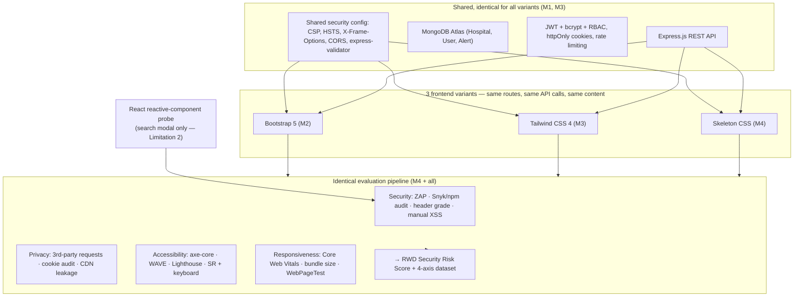

# MedReach — Corrected Research Plan

**An empirical extension of Almeida & Sousa (2026), "Security Risks in Responsive Web Design Frameworks," *Digital* 6(1), 26. DOI: 10.3390/digital6010026**

> Citation fix: the source paper has **two** authors (Fernando Almeida; Carlos Sousa). Cite it as **Almeida & Sousa (2026)** — never "Almeida et al." A wrong primary citation is the first thing a reviewer notices.

This document supersedes the earlier auto-generated plan. It restores the parts of your own `MedReach_Project_Scope.txt` and `scope.txt` that the earlier plan dropped, fixes several errors, and adds the one thing that makes this publishable rather than a replication.

---

## 1. What the paper actually leaves open (from its Section 6.3)

The paper is explicit. Its two stated limitations:

1. **Qualitative-only.** It reviews docs, CVE reports, and community practice, and classifies each framework's risk as **Y / N / P** (Table 5). It *cannot* "quantify the actual frequency or empirical impact of vulnerabilities in production environments."
2. **Framework scope.** It covers Bootstrap, Tailwind, Foundation, Pure CSS, Skeleton — but **excludes reactive-component frameworks** (React/Vue/Angular) "whose security model may differ substantially," and ignores backend-integration effects.

Its named future work: **code analysis, controlled penetration testing, lab experiments, longitudinal studies, DevSecOps-interaction studies, and deeper study of CSS-only and supply-chain attacks.**

Its headline conclusion — the pivot for our whole design: *"frontend security depends less on framework choice alone and more on governance, continuous maintenance, and the systematic adoption of secure development and DevSecOps practices."*

---

## 2. The research question (one sentence, falsifiable)

> **Holding the application, backend, and security configuration constant, does the choice of CSS framework measurably change a web application's security, privacy, accessibility, and responsiveness posture — and by how much?**

## 3. Contributions (what we produce that the paper does not)

1. **A reproducible, multi-axis measurement pipeline** run identically across framework variants (Security, Privacy, Accessibility, Responsiveness).
2. **A quantitative composite scoring instrument** (the "RWD Security Risk Score", §5) — the reusable artifact other researchers can cite and re-run. *This is the novelty. The earlier plan omitted it entirely.*
3. **An open dataset + reproduction repository** (code, scan configs, raw results, analysis notebooks).
4. **A human-subjects study** (usability + accessibility) — the human-centered evidence the paper has none of.
5. A small **reactive-framework probe** (React) that directly answers the paper's Limitation 2.

---

## 4. The result we should EXPECT (design for it, don't be surprised by it)

Because the backend, input sanitization, security headers, and CSP are **shared and identical** across all three variants, the app-level security scans will come back **nearly identical**. That is a **predicted null result on the application-security axis** — and it is *exactly what the paper's thesis predicts.* Reporting it, with numbers, is a genuine empirical confirmation the authors could not provide.

The measurable *variance* between frameworks will concentrate here — and this is where the interesting findings live:

| Paper's Table 5 claim | Our predicted measured outcome | Where the signal is |
|---|---|---|
| Bootstrap: XSS risk = **Y** | Not reproducible on Bootstrap **5** (patched); reproducible on legacy **4.x** | Version/maintenance, not "framework" |
| Tailwind: build-pipeline risk = **P** | Real, and framework-specific | Supply-chain / toolchain axis |
| Skeleton: obsolescence / "forever-day" | **Highest maintenance risk** — abandoned since ~2014, EOL | Maintenance axis |
| CSS-only attacks possible even in minimal frameworks | Demonstrable; surface differs by DOM verbosity | CSS-attack-surface axis |
| App-level XSS/CSRF (shared backend) | **Identical across variants** (null) | Confirms "governance > framework" |

**Implication:** the honest, defensible framing is *"framework choice barely moves app-level security when governance is held constant; it moves dependency, supply-chain, maintenance, and CSS-surface risk."* Do **not** promise dramatic per-framework XSS differences — you won't get them on current versions, and claiming otherwise gets you caught.

---

## 5. The RWD Security Risk Score (the instrument — core novelty)

Implemented in [`../evaluation/scoring/risk-score.js`](../evaluation/scoring/risk-score.js). A composite per variant *v*, aggregating 8 sub-dimensions from `scope.txt`. Each metric normalized to a **risk** value nᵢ ∈ [0,1] (1 = worst); weights wᵢ sum to 1:

```
Risk(v)   = Σ  wᵢ · nᵢ(v)          (Σ wᵢ = 1,  Risk ∈ [0,1])
Safety(v) = 100 · (1 − Risk(v))     → reported as an A–F letter grade
```

| # | Dimension | Raw metric(s) | Normalization nᵢ (fixed-anchored, NOT min-max) |
|---|---|---|---|
| 1 | XSS | ZAP XSS alerts (H/M/L); manual injection pass/fail | weighted count → saturating `1 − e^(−k·s)` |
| 2 | Dependencies | CVEs in tree (Snyk/npm audit), CVSS-weighted | `1 − e^(−ΣCVSS/10)` |
| 3 | Supply chain | direct+transitive dep count, depth, % maintained | fixed anchor (0 deps→0, 1500→1) |
| 4 | CSP | presence + strictness of Content-Security-Policy | ordinal: none=1 … strict-nonce=0 |
| 5 | SRI | % external resources with integrity hashes | `1 − coverage` |
| 6 | Configuration | security headers (Mozilla Observatory grade) | A→0 … F→1 |
| 7 | Maintenance | package age, release cadence, EOL status | months-since-release + EOL flag |
| 8 | CSS attack surface | CSS-only exfil/injection exploitability | ordinal from PoC result |

**Defensibility (put in Methods):**
- **Fixed anchored scales, not min-max across 3 variants** — with n=3, min-max lets one variant define the extreme and kills reproducibility. Anchor to absolute references.
- **Weights:** equal (1/8) baseline → **sensitivity analysis** (±25%, show ranking stability). Optionally CVSS-derived. Report both.
- Publish formula + all nᵢ + raw inputs so the score is reproducible.

---

## 6. Architecture (enforce "framework is the only variable")



**The parity problem you must control:** Tailwind and Skeleton ship **no JS components** — modals/dropdowns/search require added JS (Headless UI, Alpine, or hand-rolled). That JS — not the CSS framework — becomes part of the attack/perf surface. Two rules:
- **Hold the JS interaction layer constant** across Tailwind/Skeleton so you aren't measuring your own glue code.
- **Name the variable precisely:** *"the framework's bundled component/JS philosophy,"* not "CSS." Markup/class differences (semantic vs. utility vs. minimal) are intrinsic to the comparison — state it openly.

---

## 7. Four-axis evaluation methodology

**7.1 Security** — OWASP ZAP (baseline + active, same policy per variant); Snyk + `npm audit`; Mozilla Observatory header grade; manual XSS/CSRF against identical inputs. → feeds §5.
**7.2 Privacy** — third-party request count + domains (per route); functional vs. tracking cookie audit; framework CDN "phone-home"; Referrer-Policy / Permissions-Policy strictness.
**7.3 Accessibility (WCAG 2.1 AA)** — axe-core + WAVE + Lighthouse a11y; keyboard nav (Tab/Enter/Escape, focus traps); screen reader (NVDA/VoiceOver); contrast per component.
**7.4 Responsiveness & performance** — Core Web Vitals (LCP/INP/CLS, mobile+desktop); CSS/JS bundle size (raw+gzip); WebPageTest 3G/4G/WiFi; layout-breakage count across ≥5 widths.

All run in CI on every variant → structured JSON/CSV → analysis notebooks → charts.

---

## 8. Work breakdown, mapped to team & 16-week timeline

| Phase / Weeks | Owner(s) | Deliverable | Skills |
|---|---|---|---|
| **0. IRB + reproducibility setup** (Wk 1) | M1, M4 | IRB filed; repo + CI skeleton | `research-ops`, `repo-scan` |
| **1. Requirements, wireframes, schema, API spec** (Wk 1–2) | all | Figma, ER diagram, API spec | `api-design`, `database-migrations` |
| **2. Shared backend** (Wk 3–5) | M3, M1 | Express API, models, JWT+RBAC, rate-limit, shared security config, Postman | `backend-patterns`, `api-design`, `security-review` |
| **3. Three variants in parallel** (Wk 5–9) | M2/M3/M4 | 3 deployed, feature-identical apps | `nextjs-turbopack`, `react-patterns`, `frontend-patterns`, `frontend-a11y` |
| **3b. React probe** (in Wk 5–9) | M2 | search modal: safe-JSX vs `dangerouslySetInnerHTML` | `react-patterns`, `react-testing` |
| **4. Automated 4-axis eval** (Wk 10–11) | M4 + all | dataset, charts, Risk Scores | `security-scan`, `security-review`, `accessibility`, `react-performance`, `deployment-patterns`, `e2e-testing` |
| **4b. Manual pentest + PoCs** (Wk 10–11) | M4, M1 | XSS/CSRF/header findings; CSS-exfil + supply-chain demos | `security-bounty-hunter`, `security-review` |
| **5. User study** (Wk 12–13) | M4 | times, errors, SUS, NASA-TLX, interviews; ANOVA/Kruskal–Wallis | `click-path-audit`, `accessibility` |
| **6. Paper** (Wk 14–16) | all | submission-ready draft | `scientific-thinking-literature-review`, `scientific-thinking-scholar-evaluation` |

**IRB is critical-path** — human subjects incl. participants with visual impairments; not exempt. File Week 1 or the study can't be published.

---

## 9. Manual PoCs — scope & honest framing

- **CSS-only exfiltration** (attribute-selector + `background-image` side-channel vs. the login form). **Frame as operationalizing a *known* technique** (documented since ~2018) to measure CSS-attack-surface differences + validate CSP — **not** as novel. Calling it novel gets you burned in review.
- **Supply-chain demo** (simulated malicious dependency at Tailwind build time — local, sandboxed, non-registry, non-destructive). Tailwind **v4** dropped the PostCSS-plugin model for its own engine/Vite plugin — target the real v4 build step.
- All PoCs run **only against your own deployed instances.** Defensive/academic, documented responsibly.

---

## 10. Housekeeping fixes

- **Do not wholesale-delete `~/rwd-security-empirical-study/`.** It already has **Bootstrap 4.6.0** installed — the *legacy-vulnerable* condition, useful vs. patched Bootstrap 5 for the maintenance axis. Salvage the legacy PoC + the "npm audit can't see source-level CVEs" finding; fold into MedReach; then remove the rest.
- Drop skill-padding (`hexagonal-architecture` for a CRUD app, migrations for greenfield DB) — cite a skill only where it does real work.

## 11. Venue realism

Strong **empirical extension / replication-with-measurement** study. Honest read:
- **Best fit:** solid web-engineering / security-education / software-quality **conference or student research track**, or **IEEE Access** (APC-based; accepts rigorous empirical work — reviewers demand honest stats + the instrument, not tool-count).
- **Harder:** ACM TWEB, top-tier security venues — the individual techniques aren't novel enough alone.
- **What elevates it:** the **scoring instrument (§5)**, the **honest confound/null-result analysis (§4)**, the **open reproducible dataset**, the **human study**.

## 12. What would sink you in review (pre-empt these)

1. Per-framework XSS differences that vanish on patched versions → §4.
2. n=3 min-max normalization → fixed anchors (§5).
3. "Novel CSS attack" → it's known; reframe (§9).
4. Uncontrolled JS layer masquerading as the "CSS framework" variable → §6.
5. Human study with no IRB → §8, file Week 1.
6. Wrong citation ("et al.") → it's Almeida & Sousa.
