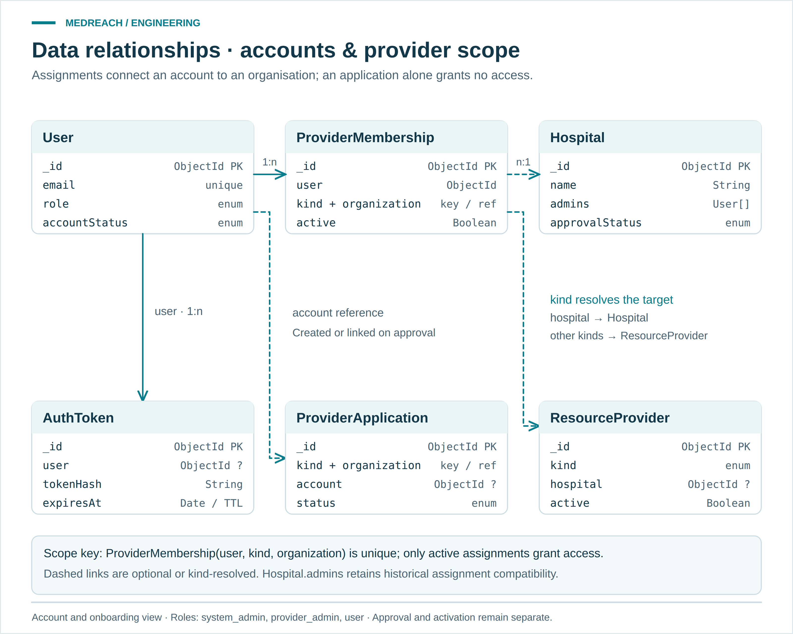
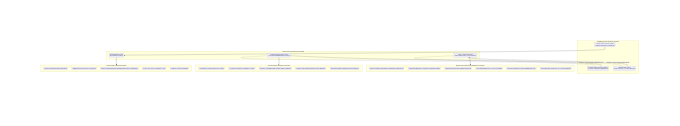
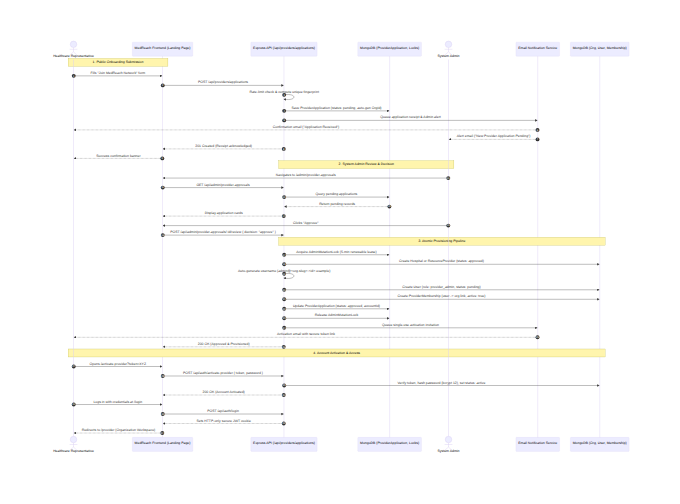
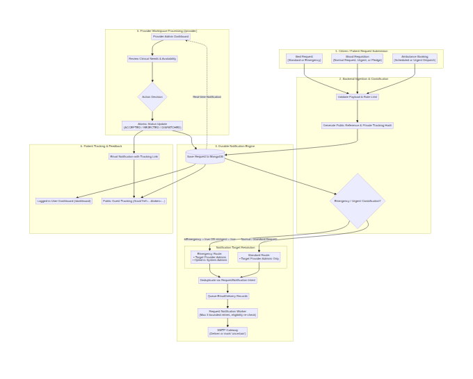
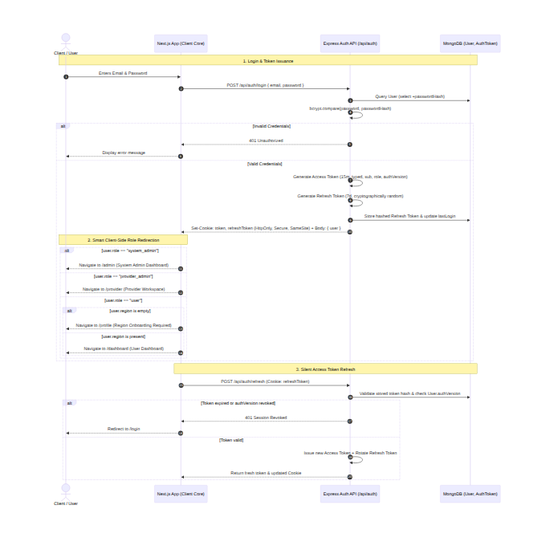

# Architecture diagrams

[Project overview](../../README.md) · [Architecture and code map](../architecture.md) · [Data dictionary](../database-schema.md)

The main figures separate **runtime structure**, **cloud boundaries** and
**data relationships**. Each is shown at full width rather than squeezed into
a thumbnail grid. PNG previews work directly in GitHub; SVGs open at any zoom.

| View | What it answers | Open separately |
| --- | --- | --- |
| [System topology](#system-topology) | What is shared, and where does code run? | [SVG](system-architecture.svg) · [PNG](system-architecture.png) |
| [Cloud deployment](#cloud-deployment) | How do Vercel, Railway, Atlas and external services connect? | [SVG](deployment-architecture.svg) · [PNG](deployment-architecture.png) |
| [Care and Careers data](#care-and-careers-data) | Which organisations receive requests and applications? | [SVG](database-er.svg) · [PNG](database-er.png) |
| [Accounts and provider scope](#accounts-and-provider-scope) | How do identity, assignments and onboarding relate? | [SVG](database-access-er.svg) · [PNG](database-access-er.png) |

## System topology

<a id="1-system-architecture"></a>

[](system-architecture.svg)

The shared client is **build-time application code**, not a fourth hosted
frontend or a gateway service. Bootstrap uses its local `_core` mirror;
Tailwind and Skeleton resolve the workspace package. All three call the same
API. Its workers run inside the API process.

Evidence: [`app.js`](../../backend/src/app.js),
[`server.js`](../../backend/src/server.js),
[frontend configurations](../../variants/README.md).
[Semantic Mermaid companion](system-architecture.mmd).

## Cloud deployment

<a id="6-deployment-architecture"></a>

[](deployment-architecture.svg)

The frontend calls the Railway API from the browser; the diagram does not imply
an additional Vercel API proxy. MongoDB and mail credentials belong on the
backend. The browser receives the public API URL and its restricted Maps key.
Resend and SMTP are alternative configured mail transports.

This documents the selected hosting arrangement and public URLs. It does not
claim to inspect Atlas regions, cluster tiers, replica counts or private
production configuration.

Evidence: [`backend/railway.json`](../../backend/railway.json),
[`emailService.js`](../../backend/src/services/emailService.js),
[deployment guide](../deployment.md).
[Semantic Mermaid companion](deployment-architecture.mmd).

## Care and Careers data

<a id="2-database-entity-relationship-er-diagram"></a>

[](database-er.svg)

This view deliberately selects the relationships needed to understand care
coordination and Careers. It is not labelled as an exhaustive collection map.
The account view below completes the `user`, `applicant` and assignment context.

- `EmergencyRequest.hospital` targets a hospital.
- `BloodRequest.provider` is optional; `AmbulanceBooking.provider` is required.
- `JobApplication.job` targets a posting. `OrganizationApplication` targets an
  organisation directly.
- Jobs and direct organisation applications can reference a hospital or a
  `ResourceProvider`.
- `hospital/provider`, `type / status` and similar combined labels are compact
  groupings of existing fields, not new schema fields.

`?` marks an optional reference; `n` means zero or more. These are logical
ObjectId references, not SQL foreign-key constraints. The figures omit full
status enums, personal contact data and most secondary fields for readability.
Use the [schema files](../../backend/src/models) for implementation detail.
[Semantic Mermaid companion](database-er.mmd).

## Accounts and provider scope

[](database-access-er.svg)

`ProviderMembership` connects a user to `(kind, organization)`. Its compound
unique index prevents duplicate assignments for the same user and organisation.
The backend additionally checks role, activation/account state and assignment
status before allowing access.

`organization` is resolved by service logic to `Hospital` or `ResourceProvider`;
it is not a fixed Mongoose `ref`. Provider applications remain pending until
review. Approval links or provisions the organisation/account; activation is a
separate access step. `Hospital.admins` remains for historical assignment
compatibility and does not create a legacy global administrator role.

[Semantic Mermaid companion](database-access-er.mmd) ·
[Permission services](../../backend/src/services/providerAccess.js)

### Other persisted models

The source tree contains **26 model files**, plus the service-defined
`AdminMutationLock`. This is a **code inventory**, not a count of live Atlas
collections. The two ER views select the main product relationships; supporting
models remain part of the application:

| Area | Model names |
| --- | --- |
| Identity and onboarding | `User`, `AuthToken`, `ProviderMembership`, `ProviderApplication`, `OwnershipClaim`, `AdminMutationLock` |
| Directory and availability | `Hospital`, `ResourceProvider`, `HospitalFacility`, `AvailabilityObservation`, `Alert`, `BloodCampaign` |
| Healthcare requests | `EmergencyRequest`, `BloodRequest`, `AmbulanceBooking` |
| Careers | `Job`, `JobApplication`, `OrganizationApplication` |
| Delivery and audit | `EmailDelivery`, `RequestNotification`, `AuditLog` |
| Stored evidence and review | `DataSource`, `FacilitySourceClaim`, `DataConflict`, `HospitalFieldClaim`, `HospitalFieldConflict`, `RefinementCandidate` |

Historical source evidence is retained. Its presence does not mean an automated
crawler is running. No diagram requires changing records or database schemas.

## Role and workflow reference views

These separate views retain their existing Mermaid sources and exports.
Expand a flow when its lifecycle detail is needed.

<a id="3-role-permission-matrix"></a>

<details>
<summary><strong>Role boundaries</strong> — platform, assigned organisation and personal access</summary>



[SVG](role-permission-matrix.svg) · [Mermaid](role-permission-matrix.mmd) · [Security guide](../security.md)

</details>

<a id="4-provider-onboarding-sequence"></a>

<details>
<summary><strong>Provider onboarding</strong> — application, review, provisioning and activation</summary>



[SVG](provider-onboarding.svg) · [Mermaid](provider-onboarding.mmd)

</details>

<a id="5-request-lifecycle--notification-flow"></a>

<details>
<summary><strong>Request notifications</strong> — normal versus emergency recipients and delivery recovery</summary>



[SVG](request-notification-flow.svg) · [Mermaid](request-notification-flow.mmd) · [Request lifecycle](../bed-request-lifecycle.md)

</details>

<a id="7-authentication--role-redirection-flow"></a>

<details>
<summary><strong>Authentication</strong> — login, session rotation and workspace routing</summary>



[SVG](auth-flow.svg) · [Mermaid](auth-flow.mmd). Token lifetimes are configurable;
consult [`env.js`](../../backend/src/config/env.js) for defaults and the deployment
configuration for actual values.

</details>

## Editing and regeneration

The four main figures use a curated layout in
[`scripts/diagram-figures.mjs`](../../scripts/diagram-figures.mjs).
Their `.mmd` files are semantic companions; Mermaid's automatic layout is not
the source of the curated PNG/SVG positions.

```sh
node scripts/render-diagrams.mjs
node scripts/render-diagrams.mjs --check
```

The default render uses installed Playwright and local Chrome, with no CDN or
application server. It produces standalone SVGs and 2× PNGs, and checks that
text fits. `--check` validates current sources and PNG dimensions without
rewriting assets. To regenerate the four separate workflow views as well, use
`--workflows`; that optional path requires network access to Mermaid's CDN.

Visuals reviewed against the implementation on **24 October 2026**. They describe
code and selected topology, not a production infrastructure or security audit.
