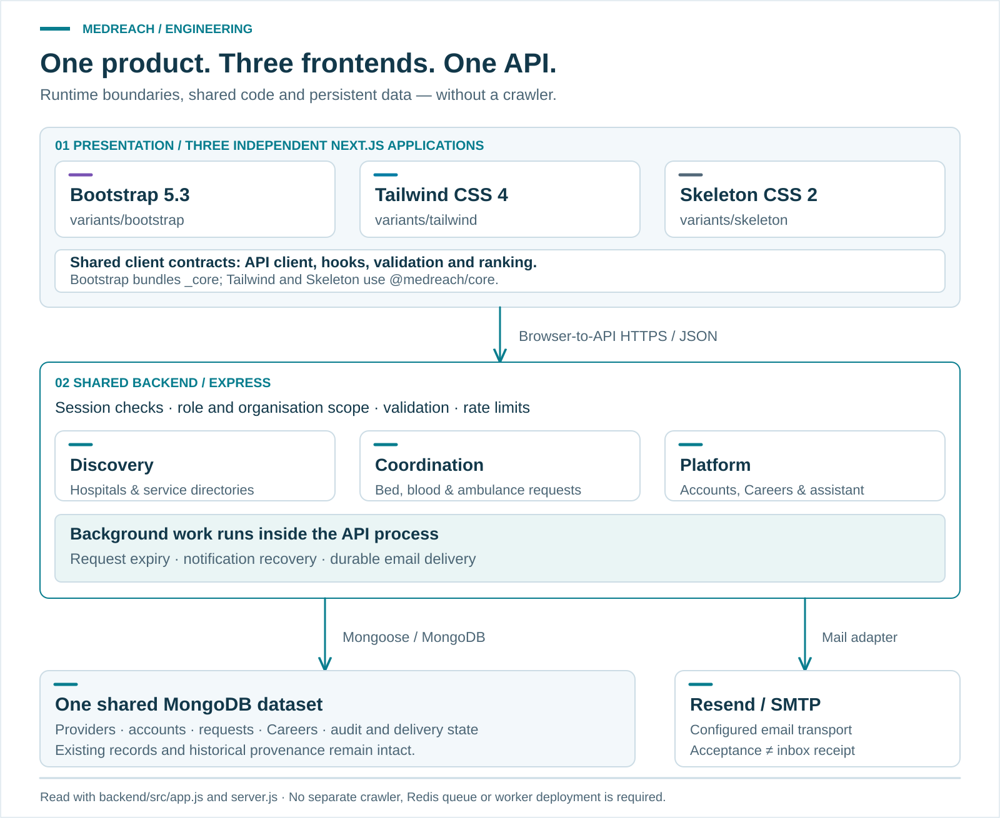
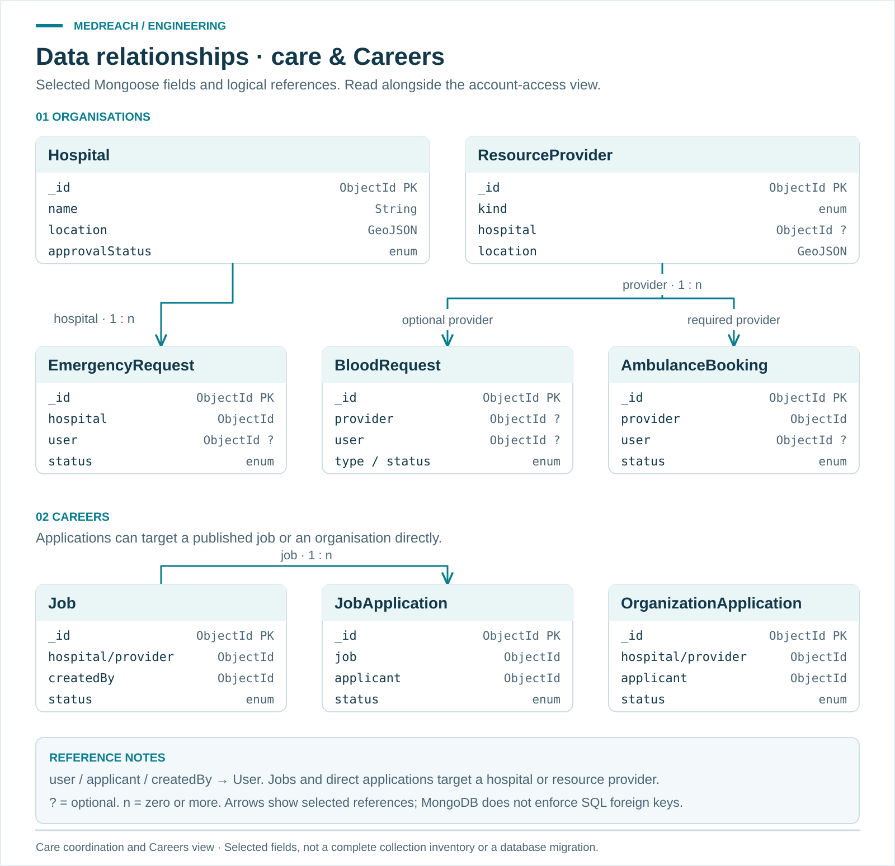
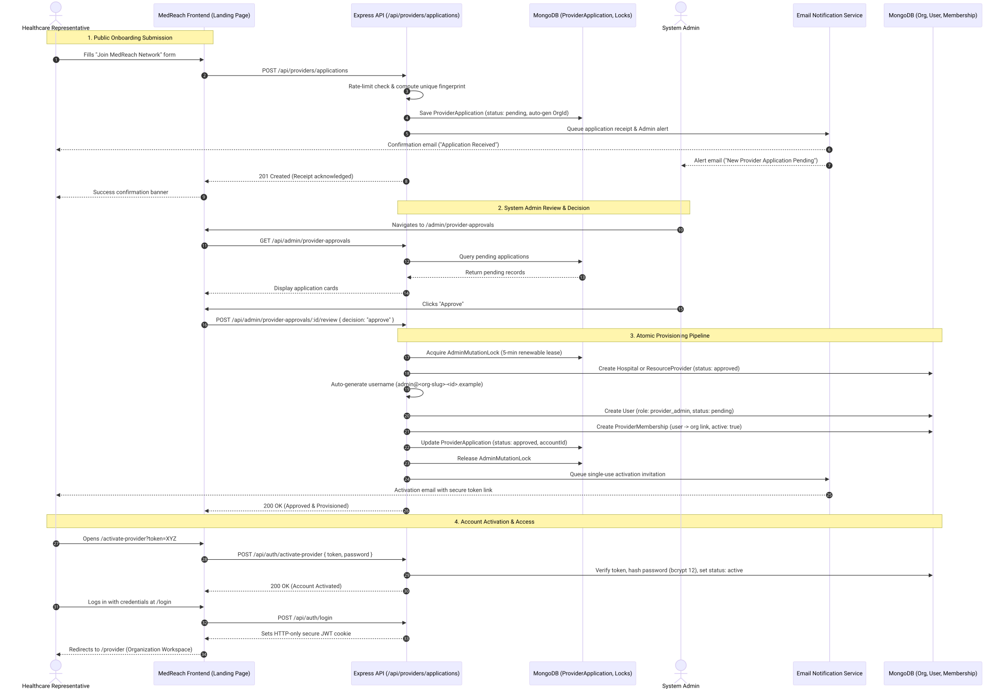
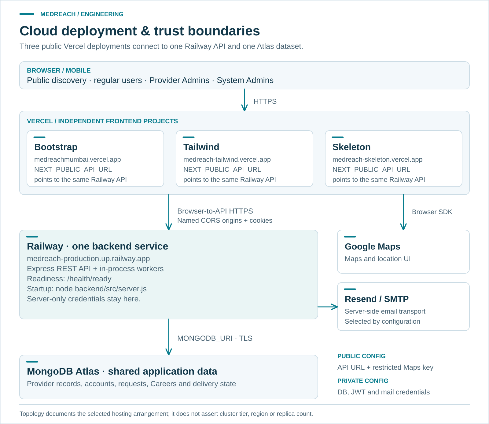
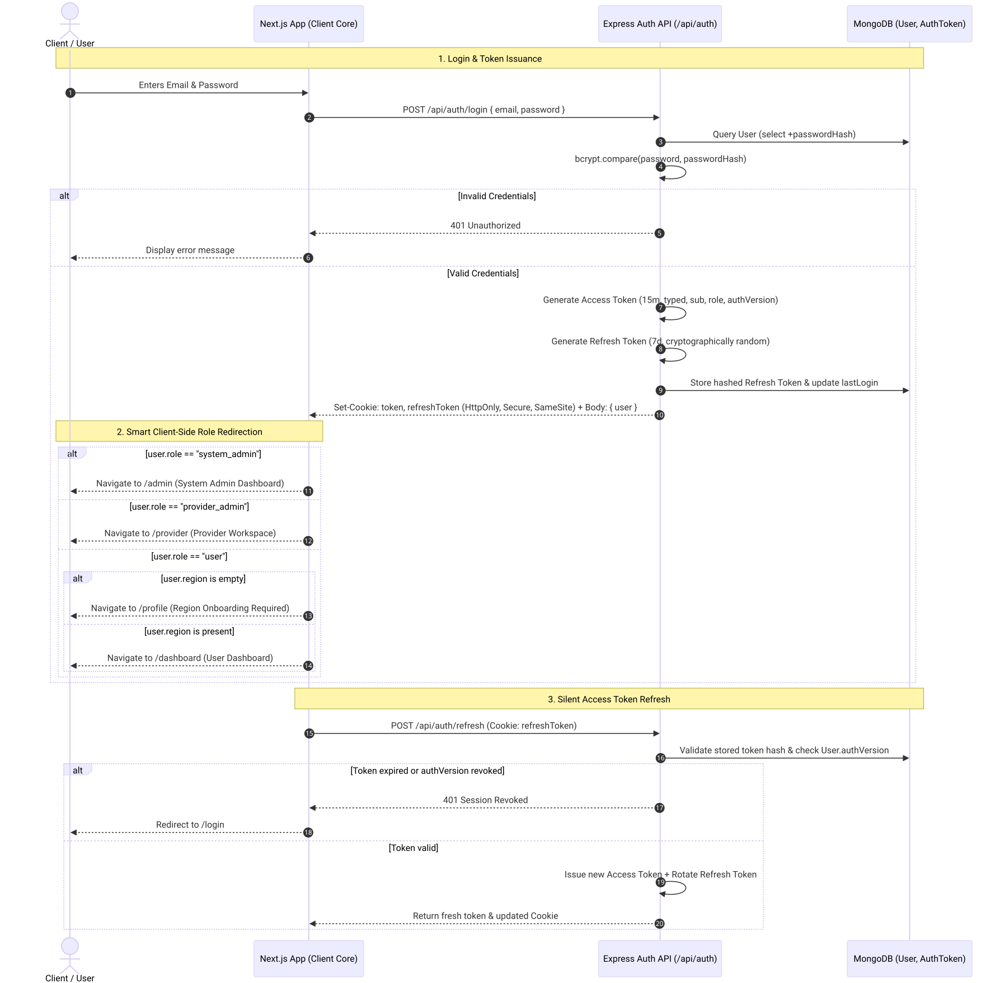

# MedReach Architecture & Workflow Diagrams

[Project Overview](../../README.md) · [Documentation Hub](../README.md) · [Architecture Guide](../architecture.md)

This directory contains the authoritative technical diagrams for MedReach, modeling system components, data relationships, role-based boundaries, onboarding lifecycles, notification dispatches, deployment topologies, and session management.

All diagrams are provided in dual formats:
- **Mermaid Source (`.mmd`):** Fully editable, version-controlled source files.
- **Rendered Vector Graphics (`.svg`):** Scalable, high-resolution vector images.
- **Rendered Raster (`.png`):** Standalone raster previews for quick viewing and presentations.

---

## Diagram Index

| # | Diagram | Type | Key Components Documented | Formats |
|---|---|---|---|---|
| 1 | [System Architecture](#1-system-architecture) | Component Graph | Frontends (Bootstrap, Tailwind, Skeleton), Shared `@medreach/core`, Security Middleware, Express API, MongoDB, Workers | [SVG](system-architecture.svg) · [PNG](system-architecture.png) · [MMD](system-architecture.mmd) |
| 2 | [Database Entity-Relationship (ER)](#2-database-entity-relationship-er-diagram) | ER Diagram | 16 Mongoose collections, cardinalities, references, compound keys, TTL and 2dsphere indexes | [SVG](database-er.svg) · [PNG](database-er.png) · [MMD](database-er.mmd) |
| 3 | [Role-Permission Matrix & Access Boundaries](#3-role-permission-matrix) | Flow / Hierarchy | `system_admin`, `provider_admin`, `user` boundaries, organization-scoped query filtering, token security | [SVG](role-permission-matrix.svg) · [PNG](role-permission-matrix.png) · [MMD](role-permission-matrix.mmd) |
| 4 | [Provider Onboarding Sequence](#4-provider-onboarding-sequence) | Sequence Diagram | Public application submission, deduplication fingerprints, System Admin review, account provisioning, activation link delivery | [SVG](provider-onboarding.svg) · [PNG](provider-onboarding.png) · [MMD](provider-onboarding.mmd) |
| 5 | [Request Lifecycle & Notification Flow](#5-request-lifecycle--notification-flow) | Flowchart | Bed, blood, and ambulance request ingestion, triage classification (emergency vs. normal), outbox queue, bounded retries | [SVG](request-notification-flow.svg) · [PNG](request-notification-flow.png) · [MMD](request-notification-flow.mmd) |
| 6 | [Deployment Architecture](#6-deployment-architecture) | Infrastructure Graph | Vercel multi-project frontend hosting, Railway Express API container, MongoDB Atlas replica set, SMTP & Maps | [SVG](deployment-architecture.svg) · [PNG](deployment-architecture.png) · [MMD](deployment-architecture.mmd) |
| 7 | [Authentication & Role Redirection Flow](#7-authentication--role-redirection-flow) | Sequence Diagram | Dual-cookie JWT auth (15m access / 7d refresh), rotation family check, session revocation, client-side route redirection | [SVG](auth-flow.svg) · [PNG](auth-flow.png) · [MMD](auth-flow.mmd) |

---

## 1. System Architecture

Shows the end-to-end multi-tier architecture connecting the three Next.js 15 frontends, the shared `@medreach/core` library, the Express security gateway, API endpoints, the persistent MongoDB database, and asynchronous background workers.

- **Source:** [`system-architecture.mmd`](system-architecture.mmd)
- **Key Invariant:** Frontends share identical API endpoints, data validation schemas, and geo-ranking logic while preserving distinct framework presentation layers.

---

## 2. Database Entity-Relationship (ER) Diagram

Illustrates all active MongoDB collections, relationships, foreign-key equivalent ObjectIds, and data privacy boundaries.

- **Source:** [`database-er.mmd`](database-er.mmd)
- **Detailed Reference:** See [`docs/database-schema.md`](../database-schema.md) for the complete collection data dictionary, field constraints, and indexing strategies.
- **Key Invariant:** No electronic health records (EHR) or clinical histories are stored. Sensitive fields (`passwordHash`, `provisioningKey`, `trackingTokenHash`) configure `select: false`.

---

## 3. Role-Permission Matrix

Visualizes the multi-tenant privilege boundaries separating platform governance, organization-scoped administration, and public citizen discovery.

- **Source:** [`role-permission-matrix.mmd`](role-permission-matrix.mmd)
- **Key Invariant:** Provider Admin authorization is strictly bound to explicit `ProviderMembership` records. Backend query filters prevent cross-organization data leakage.

---

## 4. Provider Onboarding Sequence

Traces the end-to-end provider onboarding journey from public self-service application to System Admin approval and secure account provisioning.

- **Source:** [`provider-onboarding.mmd`](provider-onboarding.mmd)
- **Key Invariant:** Submitting an application never grants immediate access. Account creation and activation tokens are only minted following explicit System Admin review.

---

## 5. Request Lifecycle & Notification Flow

Illustrates how standard and emergency requests for hospital beds, blood donations/requisitions, and ambulance bookings move through validation, classification, and durable asynchronous email notifications.

- **Source:** [`request-notification-flow.mmd`](request-notification-flow.mmd)
- **Key Invariant:** HTTP handlers await persistent intent logging before responding. Email delivery runs asynchronously with bounded retry policies and explicit "uncertain" state preservation.

---

## 6. Deployment Architecture

Documents the production cloud topology across Vercel, Railway, and MongoDB Atlas.

- **Source:** [`deployment-architecture.mmd`](deployment-architecture.mmd)
- **Key Invariant:** Three independent Vercel project deployments route back to a unified Express API container hosted on Railway, backed by a managed MongoDB Atlas replica set.

---

## 7. Authentication & Role Redirection Flow

Details the session lifecycle, JWT issuance, rotation token family tracking, and smart client-side workspace routing.

- **Source:** [`auth-flow.mmd`](auth-flow.mmd)
- **Key Invariant:** Credentials generate HttpOnly cookies and short-lived Bearer tokens. Any token family reuse detection immediately triggers revocation of all active child tokens.
