# MedReach screenshot gallery

[Project overview](../../README.md) · [Documentation](../README.md)

Captured **22 October 2026** from the actual local application at code baseline
[`1f870b4`](https://github.com/kasim672/medreach/commit/1f870b401f63ac5612217a1626259acfd278b913).
The public API read the existing local dataset. No demonstration providers were
seeded and no healthcare requests, applications or emails were submitted.

## Desktop homepages

### Bootstrap

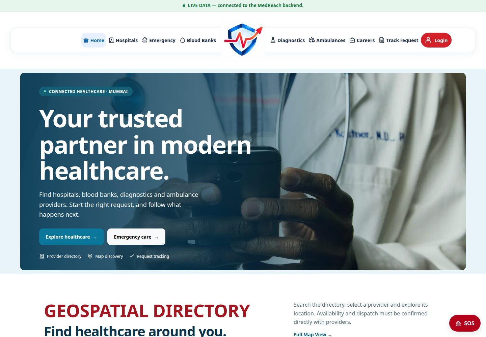

<details>
<summary>Tailwind homepage</summary>

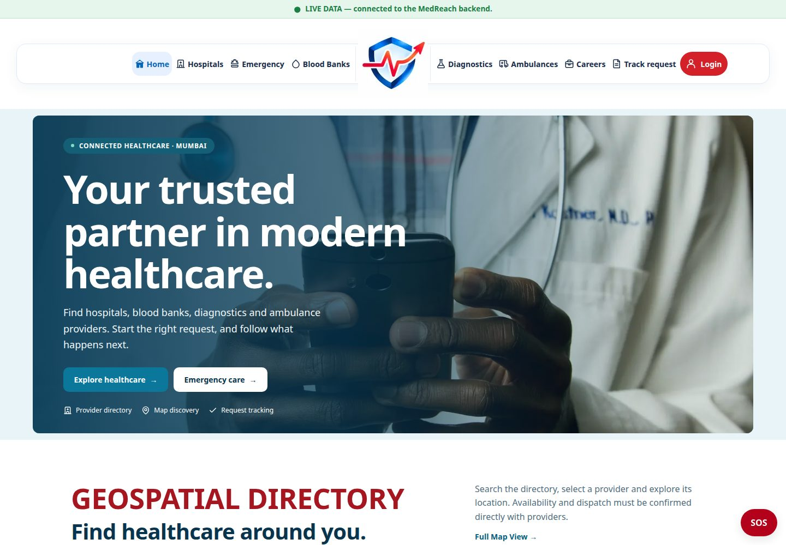

</details>

<details>
<summary>Skeleton homepage</summary>

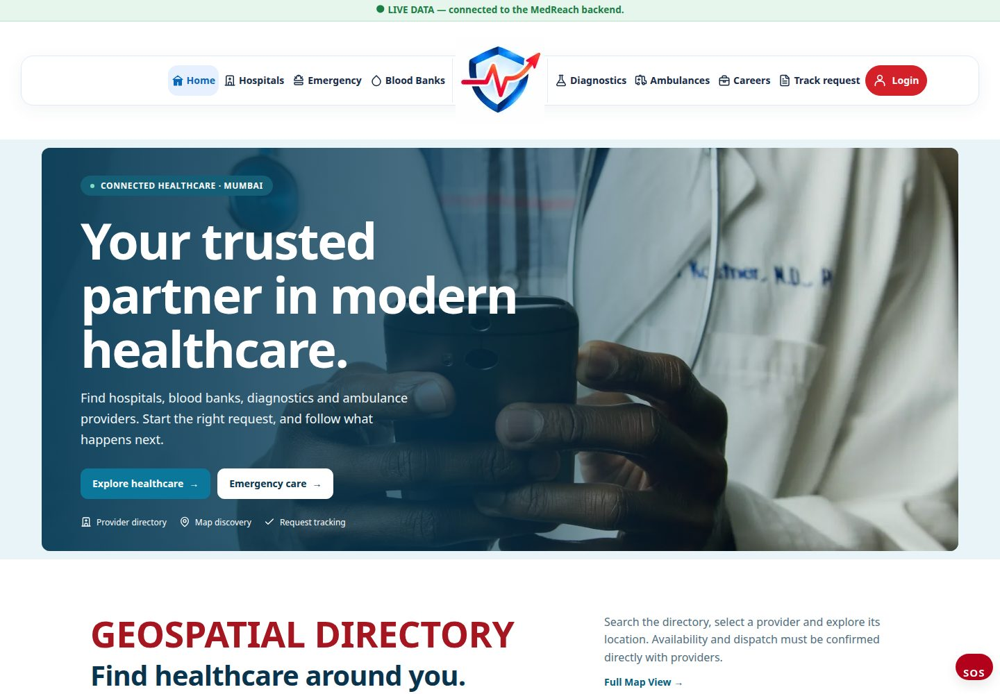

</details>

## Hospital discovery

| Bootstrap | Tailwind | Skeleton |
| --- | --- | --- |
| 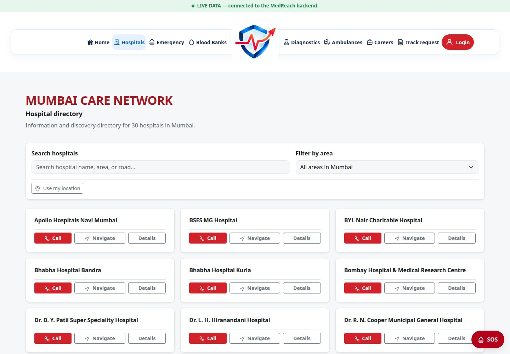 | 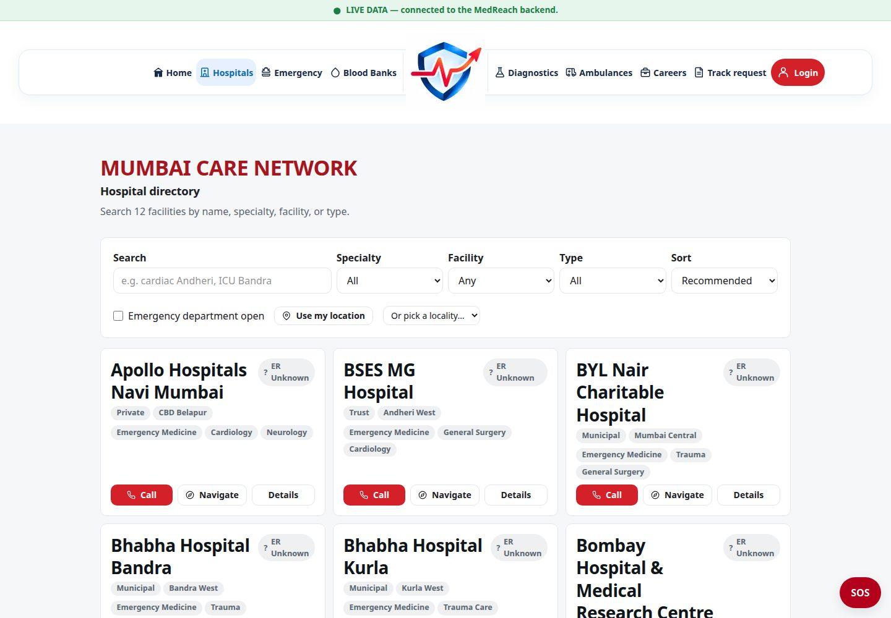 | 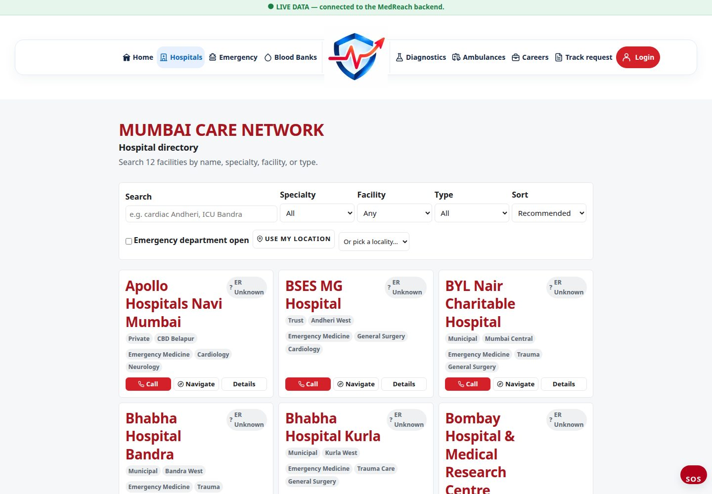 |

The directories display stored hospital records and their actual listing
actions. Listing counts and contact details reflect that local snapshot;
they do not confirm capacity or provider participation.

### Provider detail

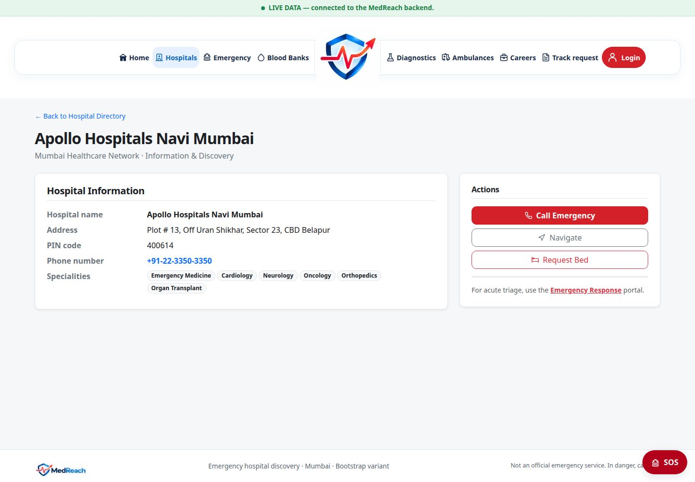

## Provider onboarding

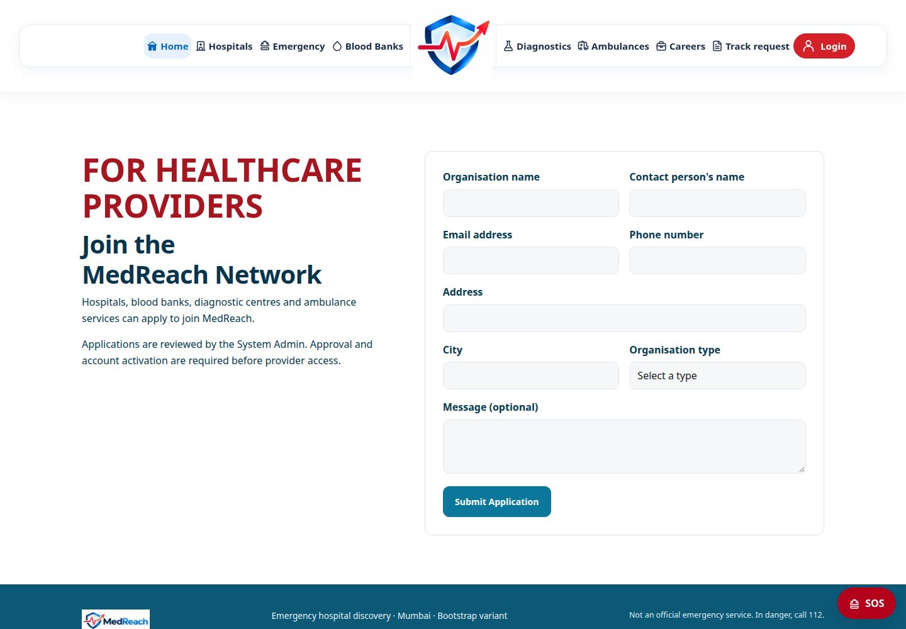

This is the unsubmitted form. System Admin review, account provisioning and
activation occur later in the protected workflow. Private administration pages
are deliberately absent from this public gallery.

## Careers and blood services

| Healthcare Careers | Blood-bank and campaign page |
| --- | --- |
| 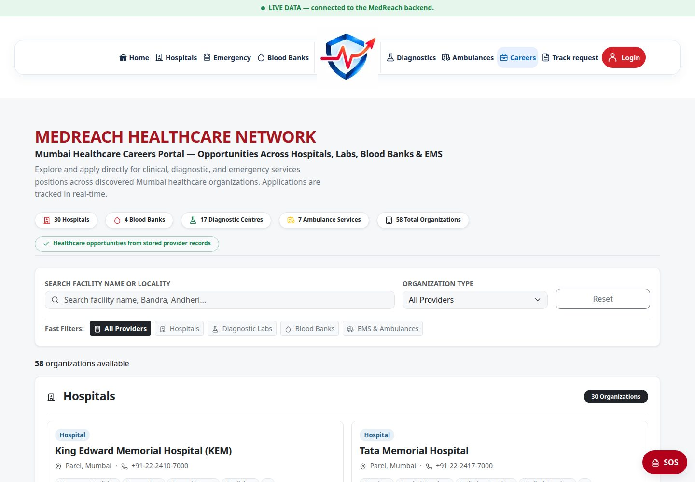 | 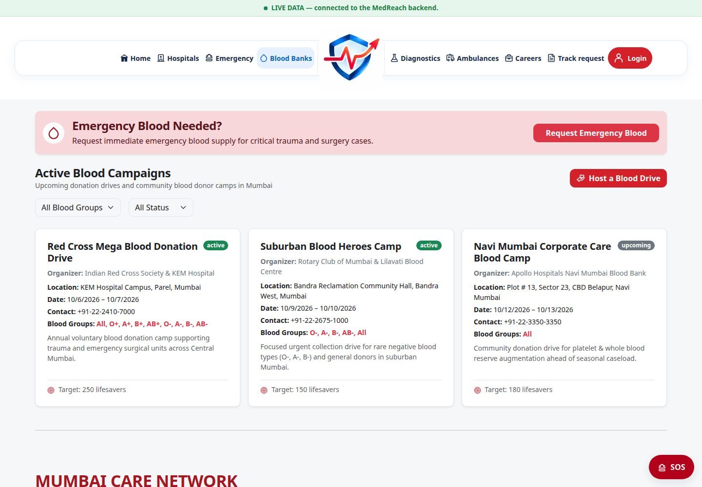 |

Campaign dates, statuses and organisation counts are stored application data,
not a current operational recommendation. Blood groups on a listing do not
establish current inventory.

## Emergency discovery

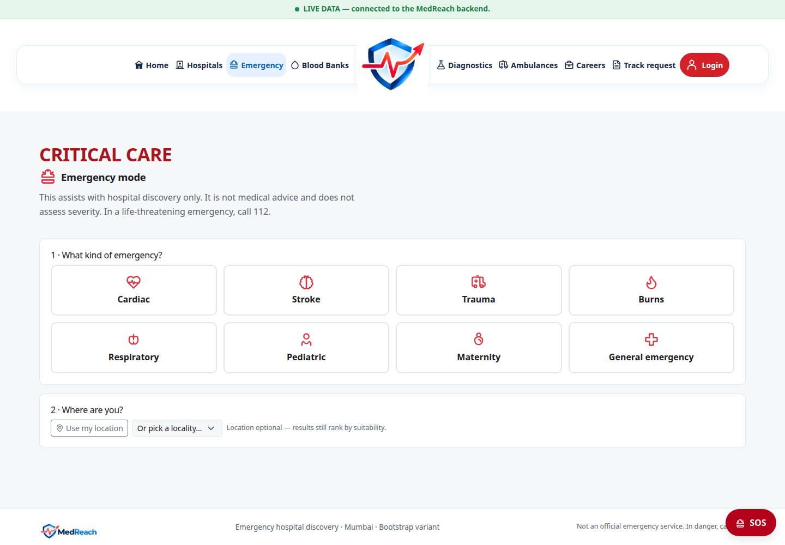

No emergency request was submitted. This interface supports discovery and
coordination; it does not assess severity or guarantee dispatch.

## Mobile homepages

| Bootstrap | Tailwind | Skeleton |
| --- | --- | --- |
| 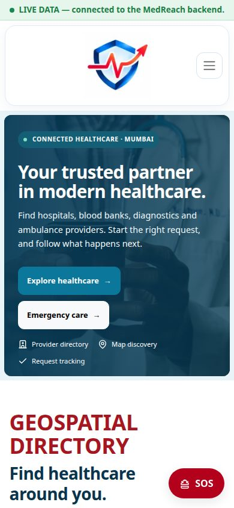 | 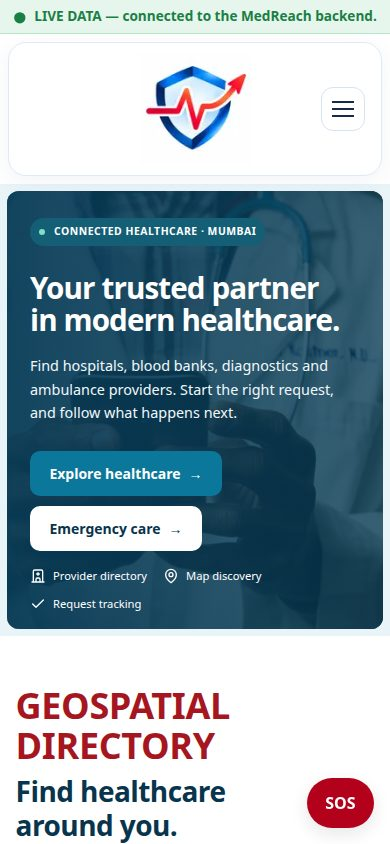 | 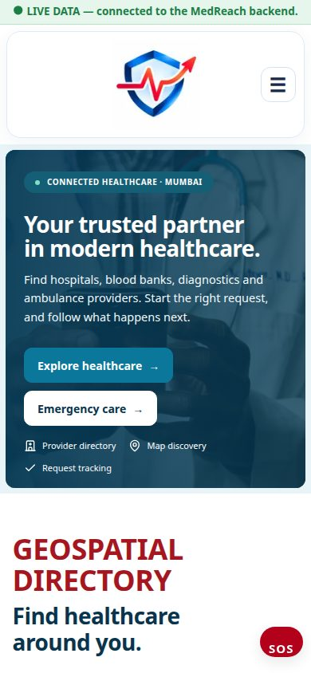 |

Mobile viewport: **390 × 844**. Desktop viewport: **1440 × 1000**.
All 14 captured states passed the screenshot tool's horizontal-overflow check.
This is not a full visual-regression or accessibility audit.

## Capture method and safety

- Local production builds from the recorded code baseline; reduced motion enabled.
- A loopback-only Express preview used the actual API with **automatic index/collection creation disabled**.
- The preview permitted public reads only, blocked write methods and started no expiry/email/recovery workers.
- The browser had a fresh anonymous session and blocked non-read methods and external requests.
- All 34 local collection document hashes and counts were compared before/after capture.
- The test build has no Maps key. These images do not claim live Google Maps validation.
- JPEG quality 82 at native viewport resolution; no composited UI, generated records or screenshot retouching.
- Images depict MedReach's existing interface and supplied artwork; no new external asset was acquired. They do not establish rights to redistribute underlying third-party artwork beyond its existing permission.

Capture metadata is recorded in [manifest.json](current/manifest.json).
Older ignored images outside `current/` are not part of this published gallery.

### Refresh the screenshots

Prepare reviewed local previews at `http://localhost:3400`, `:3401` and `:3402`
with a matching API build URL. For the existing dataset, use a read-only wrapper
around `createApp()` with Mongoose `autoIndex: false` and `autoCreate: false`;
do not start `server.js` workers solely to take pictures. Do not run fixture
seeding or use production/private accounts.

Install the Playwright browser on a new workstation, then run from the root:

```sh
npx playwright install chromium
node scripts/capture-all-screenshots.mjs
```

With an already installed Chrome, the alternative used for this capture is:

```sh
MEDREACH_PLAYWRIGHT_CHANNEL=chrome node scripts/capture-all-screenshots.mjs
```

Optional `MEDREACH_DOCS_BOOTSTRAP_URL`, `MEDREACH_DOCS_TAILWIND_URL` and
`MEDREACH_DOCS_SKELETON_URL` override preview origins. The tool rejects remote
origins, credentials and URL paths. It never connects to MongoDB, seeds data,
signs in, submits forms or sends mail. Browser GET requests still reach the
configured API, so that preview's read-only configuration must be checked first.

Review every new image and its metadata before publishing. Never capture
password fields, admin credential handovers, patient histories, application
resumes or private tracking URLs.
