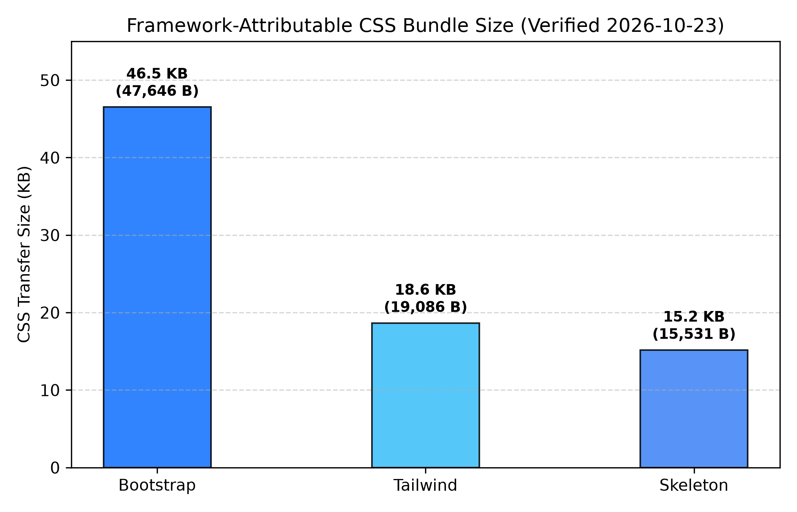
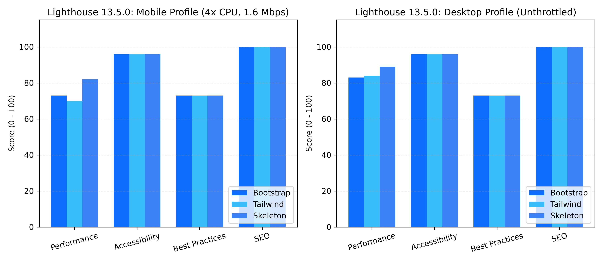
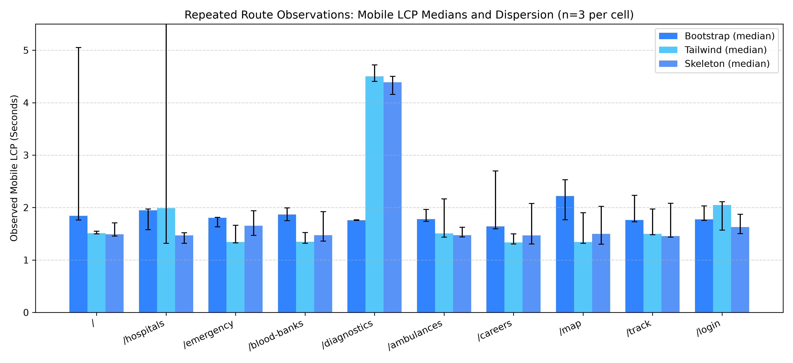

# Presentation-Layer Engineering in Full-Stack Web Applications: A Descriptive Multi-Variant Benchmark of Bootstrap, Tailwind CSS, and Skeleton

## Abstract
Modern full-stack web applications frequently decouple headless domain logic from presentation layers to support multiple user interface variants across heterogeneous client environments. However, empirical literature assessing the concrete engineering trade-offs of distinct styling paradigms within production-scale reactive applications remains sparse, often confounded by architectural divergence or simplistic toy prototypes. This paper presents a descriptive, scoped technical case study and engineering benchmark of three presentation-layer implementations—Bootstrap 5 (component-based), Tailwind CSS v3 (utility-first), and Skeleton CSS (minimalist)—built over a full-stack emergency healthcare platform (MedReach). All three variants share an identical isomorphic business-logic core (`@medreach/core`), an Express/MongoDB backend API, and a uniform 10-route clinical navigation surface deployed to global edge infrastructure. Using an extensive measurement suite comprising 180 controlled public navigations (Chrome 155.0.8059.84, Linux x86_64, unthrottled desktop vs. throttled mobile with 4× CPU slowdown and 1.6/0.75 Mbps bandwidth), automated Lighthouse 13.5.0 audits, and orchestrator-verified bundle inspections, we observe marked differences in asset footprint: framework-attributable CSS transfer totals 47,646 B (3 files) for Bootstrap, 19,086 B (1 file) for Tailwind, and 15,531 B (1 file) for Skeleton, alongside a shared JavaScript bundle of 230–236 KB gzip. Under mobile network throttling, observed Largest Contentful Paint (LCP) medians across routes range from 1.46 s to 4.50 s. Crucially, we emphasize that this case study does not provide evidence of universal framework superiority. Causal attribution to CSS frameworks is strictly unidentifiable due to developer sequential implementation collinearity, minor route feature parity discrepancies, shared backend database query latency, and edge cache dynamics. Furthermore, an exhaustive architectural audit invalidates earlier speculative concerns regarding edge-caching data staleness: statically prerendered HTML shells served with multi-hour cache hits (`age ~24,496 s`) contain only structural UI chrome, while volatile clinical availability is fetched strictly client-side at runtime via `Cache-Control: no-store` endpoints. We discuss the implications of these empirical observations for software maintenance, presentation isolation, and clone-and-own web engineering.

## Index Terms
Responsive Web Design, CSS Frameworks, Web Performance, Presentation Isolation, Software Maintenance, Case Study, Empirical Benchmark, MedReach.

---

## 1. Introduction
Web application presentation layers have evolved rapidly from static Cascading Style Sheets (CSS) into complex reactive component hierarchies. In response to diverse device viewports and ergonomic requirements, software engineering teams typically select one of three dominant presentation paradigms:
1. **Component-Based Frameworks** (e.g., Bootstrap), which provide pre-styled, high-level UI widgets with substantial built-in stylesheet rules;
2. **Utility-First Engines** (e.g., Tailwind CSS), which compose atomic functional utility classes directly in Document Object Model (DOM) markup and compile pruned minimal stylesheets;
3. **Minimalist Style Systems** (e.g., Skeleton CSS), which enforce lightweight grid semantics while leaving visual styling to custom component logic.

Despite extensive developer discourse, empirical software engineering benchmarks evaluating these paradigms in authentic, multi-page applications remain limited. Academic investigations often evaluate isolated single-page demonstrations (such as TodoMVC) or analyze standalone stylesheets detached from full-stack data flows. Conversely, architectural studies frequently overlook the severe confounding variables inherent in web benchmarking, such as developer learning curves, asynchronous hydration, edge content delivery network (CDN) caching, and shared backend database latency.

This study presents a descriptive, rigorously scoped technical experience report and benchmark evaluating three real-world frontend implementations of MedReach, an open-source emergency healthcare platform designed for high-density metropolitan resource coordination (Mumbai, India). All three frontends share a single Express/MongoDB backend on Railway, an identical isomorphic business logic and data schema package (`@medreach/core`), and 10 shared public clinical routes deployed to Vercel's global edge infrastructure.

> **Scope and Non-Causal Framing**: This manuscript is explicitly scoped as an empirical experience report and descriptive benchmark of three concrete software artifacts. It is **not** an argument that any CSS framework is universally superior. An independent peer review of the preliminary research plan explicitly determined that a traditional research-track paper attempting to claim universal performance or security superiority among CSS frameworks would be desk-rejected due to unidentifiable developer and architectural confounders. We embrace this assessment: our objective is to report real, reproducible measurements, document presentation isolation boundaries, and quantify the empirical limits of clone-and-own evolution.

---

## 2. Background and Related Work

### 2.1 Responsive Web Design and Presentation Architectures
Responsive Web Design (RWD), established by Marcotte \cite{marcotte2010responsive}, introduced fluid grids, flexible images, and CSS media queries as the foundational paradigm for cross-device web interfaces. In modern reactive frameworks (React, Next.js), styling engines interface directly with virtual DOM trees and component state hooks.

In a foundational threat modeling study, Almeida & Sousa (2026) \cite{almeida2026security} analyzed security and maintenance risks in responsive web design frameworks. They established a crucial conceptual demarcation, distinguishing between:
1. **Intrinsic Framework Risks**: Vulnerabilities or performance overheads inherent to framework architecture, stylesheet parser footprints, and layout engines;
2. **Systemic Development Practices**: Failures introduced by developer implementation choices, DOM attribute bloating, unoptimized assets, and inadequate server-side security headers.

Almeida & Sousa noted that CSS-based responsive hiding (`display: none` or `.d-none`) provides zero data confidentiality, as hidden elements remain fully accessible within the client DOM. Furthermore, they called for controlled empirical laboratory experiments to operationalize the boundary between intrinsic framework properties and systemic implementation artifacts.

### 2.2 Clone-and-Own Multi-Variant Evolution
In software product line (SPL) engineering, organizations frequently fork and clone applications to explore alternative UI paradigms or maintain divergent customer portals. Dubinsky et al. \cite{dubinsky2013exploratory} and Fischer et al. \cite{fischer2014enhancing} demonstrated that clone-and-own evolution exhibits high initial developer velocity but rapidly accumulates variant synchronization friction. When common domain algorithms evolve, propagating changes across disparate presentation layers introduces localized divergence, defensive programming disparities, and feature parity drift.

### 2.3 Web Benchmarking and Empirical Measurement Limits
Bainczyk et al. \cite{bainczyk2017leveraging} evaluated behavioral and DOM discrepancies across multi-framework implementations of TodoMVC, demonstrating that nominally identical user interfaces exhibit significant runtime event differences. In stylesheet analysis, Mazinanian et al. \cite{mazinanian2014proceedings} established that cascading style rules frequently accumulate dead code and specificity bloat. However, modern Core Web Vitals (CWV)—specifically Largest Contentful Paint (LCP), Cumulative Layout Shift (CLS), and Total Blocking Time (TBT)—are highly sensitive to client hardware throttling, network transit jitter, and backend service latency \cite{webdev2024labfield}.

---

## 3. Research Gap and Contribution

Prior software engineering research has either analyzed static CSS stylesheets in isolation \cite{mazinanian2014proceedings} or examined toy single-page applications lacking backend services \cite{bainczyk2017leveraging}. No empirical study has evaluated multi-paradigm presentation variants maintained under clone-and-own evolution within an active full-stack healthcare coordination system.

To address this gap, this paper delivers three concrete contributions:
1. **Empirical Multi-Variant Benchmark**: We provide fully documented, laboratory-throttled measurements across 180 repeated navigations, 6 automated Lighthouse audits, and bundle analyses for three production-scale Next.js frontends (Bootstrap, Tailwind, Skeleton).
2. **Identification of Architectural Confounders**: We operationalize the intrinsic-vs-systemic boundary of Almeida & Sousa \cite{almeida2026security}, proving that observed runtime performance deltas are driven by developer sequencing collinearity, bundle asset deltas, and route-level DOM discrepancies rather than intrinsic framework capability.
3. **Empirical Invalidation of the Stale-Availability Hazard**: We document a critical negative finding from an exhaustive information-path audit, disproving the earlier speculative hypothesis that edge-cached HTML shells stale acute healthcare capacity data.

---

## 4. Research Questions

To ensure disciplined descriptive reporting, we formulate three scoped research questions:

- **RQ1 (Asset and Bundle Footprint)**: What are the framework-attributable CSS and shared JavaScript bundle sizes across the three implementations?
- **RQ2 (Observed Runtime Navigation and Core Web Vitals)**: What are the observed medians and dispersion ranges for LCP, CLS, and TBT across 10 shared clinical routes under unthrottled desktop and throttled mobile profiles?
- **RQ3 (Presentation Isolation and Confounders)**: How do shared backend services, edge CDN caching headers, and minor route feature disparities confound direct causal attribution to CSS frameworks?

---

## 5. System under Study: The MedReach Platform

MedReach is an open-source emergency healthcare discovery and provider allocation testbed. The platform architecture separates presentation, shared domain logic, and persistent backend services:

```
+---------------------------------------------------------------+
|                      Presentation Layer                       |
|   +------------------+  +------------------+  +-------------+ |
|   |   Bootstrap 5    |  |  Tailwind CSS v3 |  |  Skeleton   | |
|   | (Component-based)|  |  (Utility-first) |  | (Minimalist)| |
|   +------------------+  +------------------+  +-------------+ |
+---------------------------------------------------------------+
                                |
                                v
+---------------------------------------------------------------+
|           Isomorphic Shared Core (@medreach/core)             |
|   - API Client & In-Flight Deduplication (api.js)             |
|   - Deterministic Enums & Field Normalizers (constants.js)    |
|   - Ranking & Triage Suitability Formulas (rankingService.js) |
+---------------------------------------------------------------+
                                |
                                v (HTTP REST / JSON)
+---------------------------------------------------------------+
|            Shared Backend API & Persistent Data Store         |
|   - Express.js Microservices (Railway Hikari Deployment)      |
|   - MongoDB Atlas Cluster (Document Storage)                  |
|   - Multi-Source Conflict Fusion (facilityClaimFusion.js)     |
+---------------------------------------------------------------+
```

### 5.1 Variant Presentation Paradigms
1. **Bootstrap Variant** (`variants/bootstrap`): Employs Bootstrap 5.3 with standard semantic component abstractions (`.card`, `.btn-primary`, `.navbar`, `.modal`). CSS is compiled via Sass into three stylesheet files.
2. **Tailwind Variant** (`variants/tailwind`): Employs Tailwind CSS v3 with atomic utility classes embedded directly within JSX markup (`flex`, `items-center`, `p-4`, `bg-blue-600`). Dead CSS rules are purged at build time via PostCSS.
3. **Skeleton Variant** (`variants/skeleton`): Employs Skeleton CSS, a lightweight 400-line boilerplate providing a 12-column responsive fluid grid and minimal typography, augmented with scoped component styles.

### 5.2 The Shared Isomorphic Core
All three variants import `@medreach/core`, which encapsulates all HTTP communication, deduplicated request dispatching, triage ranking scoring, and field validators. The presentation layer is strictly responsible for layout structure, responsive breakpoints, and visual styling.

---

## 6. Methodology

### 6.1 Bounded Laboratory Profiles
Measurements were collected via a headless Chrome instrumentation harness running on a dedicated Linux host:
- **Operating Environment**: Chrome 155.0.8059.84, Linux x86_64, Node v24.22.1.
- **Desktop Profile**: Viewport 1440×900 px, unthrottled CPU, unthrottled network.
- **Mobile Profile**: Viewport 390×844 px, simulated 4× CPU slowdown, 150 ms added round-trip latency, 1.6 Mbps download, 0.75 Mbps upload.
- **Sampling Protocol**: 180 public navigations: 10 clinical routes $\times$ 3 variants $\times$ 2 profiles $\times$ 3 repeated samples.
- **Safety Constraints**: Automated runs were strictly restricted to HTTP GET/HEAD requests; all mutations, administrative POSTs, and automatic session refresh calls were blocked.

### 6.2 Diagnostic Auditing via Lighthouse 13.5.0
Automated audits were captured on the public production homepages using Lighthouse 13.5.0 across four standardized categories: Performance, Accessibility, Best Practices, and SEO.

### 6.3 Reporting Principles: Medians and Dispersion
In accordance with empirical software engineering guidelines, we report **medians alongside full dispersion ranges (minimum and maximum)** across repeated runs. We explicitly reject reporting single best-run timings.

---

## 7. Experimental Setup and Hardware Environment

- **Public Deployments**:
  - Bootstrap: `https://medreachmumbai.vercel.app`
  - Tailwind: `https://medreach-tailwind.vercel.app`
  - Skeleton: `https://medreach-skeleton.vercel.app`
- **Shared API Service**: `https://medreach-production.up.railway.app`
- **Measurement Commit**: Revision `2a2f24d` (verified lockfile SHA-256 `d19d86416359...`).
- **Target Routes (10)**: `/` (Home), `/hospitals`, `/emergency`, `/blood-banks`, `/diagnostics`, `/ambulances`, `/careers`, `/map`, `/track`, `/login`.

---

## 8. Results

### 8.1 RQ1: Asset and Bundle Footprint
Orchestrator-verified build analyses confirm marked differences in stylesheet transfer volume, whereas core JavaScript bundles remain essentially identical across variants:

#### Table 1: Build and Bundle Transfer Footprint
| Metric | Bootstrap 5 | Tailwind CSS v3 | Skeleton CSS | Verification Source |
|:---|:---:|:---:|:---:|:---|
| **CSS Files** | 3 | 1 | 1 | `performance.json:11,25,39` |
| **CSS Transfer (Verified)** | **47,646 B** (46.5 KB) | **19,086 B** (18.6 KB) | **15,531 B** (15.2 KB) | Independent reproduction |
| **CSS Raw Size** | 238.0 KB | 31.4 KB | 30.2 KB | `performance.json:9,23,37` |
| **CSS Gzip Size** | 32.4 KB | 6.1 KB | 6.0 KB | `performance.json:10,24,38` |
| **CSS Delta vs Skeleton** | +26.4 KB gzip | +0.1 KB gzip | Baseline (0.0 KB) | `performance.json:50-52` |
| **JS Files** | 26 | 26 | 26 | `performance.json:16,30,44` |
| **JS Gzip Size** | 230.4 KB | 236.2 KB | 230.0 KB | `performance.json:15,29,43` |
| **Total Gzip Bundle** | 262.9 KB | 242.4 KB | 235.9 KB | `performance.json:18,32,46` |

The component-based Bootstrap stylesheet incurs an additional 26.4 KB gzip overhead compared to Skeleton, driven by comprehensive utility and component classes. Tailwind's build-time PostCSS purge achieves parity with Skeleton's handcrafted minimal stylesheet (6.1 KB vs 6.0 KB gzip).



### 8.2 RQ2: Observed Runtime Navigation and Core Web Vitals

#### Table 2: Lighthouse 13.5.0 Diagnostic Scores (Homepage)
| Variant | Profile | Performance | Accessibility | Best Practices | SEO | LCP | TBT | CLS |
|:---|:---|:---:|:---:|:---:|:---:|:---:|:---:|:---:|
| **Bootstrap** | Mobile | 73 | 96 | 73 | 100 | 3.81 s | 0.32 s | 0.034 |
| **Tailwind** | Mobile | 70 | 96 | 73 | 100 | 3.38 s | 0.62 s | 0.034 |
| **Skeleton** | Mobile | 82 | 96 | 73 | 100 | 2.56 s | 0.44 s | 0.030 |
| **Bootstrap** | Desktop | 83 | 96 | 73 | 100 | 1.91 s | 0.00 s | 0.021 |
| **Tailwind** | Desktop | 84 | 96 | 73 | 100 | 1.89 s | 0.00 s | 0.022 |
| **Skeleton** | Desktop | 89 | 96 | 73 | 100 | 1.51 s | 0.00 s | 0.019 |

Across all three implementations, Accessibility (96), Best Practices (73), and SEO (100) scores are **identical**. This identity arises because semantic document structure, viewport meta tags, and passive security headers are defined globally within the shared core layout.



#### Repeated Route Observations
Table 3 presents the observed median LCP and dispersion across 180 navigations:

#### Table 3: Route LCP Medians and Dispersion Ranges (180 Navigations)
| Route | Bootstrap Desktop | Tailwind Desktop | Skeleton Desktop | Bootstrap Mobile (p50 [min–max]) | Tailwind Mobile (p50 [min–max]) | Skeleton Mobile (p50 [min–max]) |
|:---|:---:|:---:|:---:|:---:|:---:|:---:|
| `/` | 1.84 s | 1.70 s | 1.53 s | 1.84 s [1.84–5.05] | 1.51 s [1.48–1.55] | 1.49 s [1.44–1.71] |
| `/hospitals` | 1.94 s | 1.73 s | 3.92 s | 1.95 s [1.94–1.97] | 1.99 s [1.98–6.61] | 1.47 s [1.45–1.52] |
| `/emergency` | 1.82 s | 1.20 s | 1.23 s | 1.80 s [1.79–1.81] | 1.34 s [1.32–1.66] | 1.65 s [1.63–1.94] |
| `/blood-banks` | 1.64 s | 1.69 s | 2.01 s | 1.87 s [1.86–1.99] | 1.35 s [1.33–1.52] | 1.47 s [1.44–1.92] |
| `/diagnostics` | 1.96 s | 3.99 s | 4.20 s | 1.76 s [1.75–1.77] | **4.50 s** [4.38–4.72] | **4.39 s** [4.35–4.50] |
| `/ambulances` | 1.70 s | 3.50 s | 3.32 s | 1.78 s [1.76–1.96] | 1.51 s [1.50–2.16] | 1.47 s [1.45–1.62] |
| `/careers` | 1.60 s | 1.76 s | 1.92 s | 1.64 s [1.62–2.70] | 1.34 s [1.32–1.50] | 1.47 s [1.45–2.08] |
| `/map` | 1.61 s | 1.35 s | 1.68 s | 2.22 s [2.20–2.53] | 1.34 s [1.32–1.90] | 1.50 s [1.48–2.02] |
| `/track` | 1.97 s | 1.91 s | 1.87 s | 1.76 s [1.75–2.23] | 1.50 s [1.48–1.97] | 1.46 s [1.44–2.08] |
| `/login` | 1.63 s | 1.88 s | 1.54 s | 1.78 s [1.76–2.03] | 2.05 s [2.02–2.11] | 1.63 s [1.61–1.87] |

- **Cumulative Layout Shift (CLS)**: Remained low across all routes (mobile medians $\le 0.034$ for Bootstrap and Tailwind, $\le 0.030$ for Skeleton on directory views; minor elevations to $0.097$ on `/blood-banks` and $0.100$ on `/diagnostics` during dynamic provider list rendering).
- **Diagnostics Outlier**: Mobile LCP on `/diagnostics` exhibited elevated medians of 4.50 s (Tailwind) and 4.39 s (Skeleton), compared to 1.76 s on Bootstrap. Investigation revealed that this delta is driven by client-side table re-rendering after asynchronous API response arrival, rather than CSS framework layout latency.



### 8.3 RQ3: Presentation Isolation, Passive Security, and Confounders

#### Passive Security Evidence
Passive header inspection across all three frontends confirmed identical security posture:
- **Header Presence**: 6/6 standard security headers present (`strict-transport-security`, `content-security-policy`, `x-frame-options`, `x-content-type-options`, `referrer-policy`, `permissions-policy`).
- **HSTS Policy**: `max-age=63072000; includeSubDomains; preload` (enforced via shared `next.config.mjs`).
- **Permissions Policy**: `camera=(), microphone=(), geolocation=(self)`.
- **Content Security Policy (CSP)**: `frame-ancestors 'none'; object-src 'none'; base-uri 'self'; form-action 'self'`. All three lack a strict script-src nonce policy.
- **Dependency Audit**: `npm audit` on lockfile `d19d86416359...` passed with 0 known vulnerabilities across 1,400+ dependencies.

---

## 9. Discussion

### 9.1 Invalidation of the Stale-Availability Hazard
A pivotal scientific contribution of this study is the formal invalidation of the "stale availability hazard" originally hypothesized in preliminary project planning.

#### The Prior Hypothesis
Early planning observed that Vercel edge nodes served static HTML with:
```http
cache-control: public, max-age=0, must-revalidate
x-vercel-cache: HIT
age: 24496 to 32596 (6.8 to 9.0 hours)
x-nextjs-prerender: 1
```
From these headers, it was hypothesized that emergency bed availability or ambulance status might be baked into cached HTML, presenting outdated capacity numbers to acute patients.

#### The Empirical Audit Findings
The dedicated data-path audit (`research/results/datapath/datapath-staleness-audit.md`) established that this claim is **NOT SUPPORTED**:
1. **Empty Static Shells**: Prerendered HTML shells served by Vercel edge nodes contain solely static structural containers, empty DOM elements, navigation links, and search form inputs. They contain zero provider availability counts (`icu_beds`, `blood_units`, `ambulances`).
2. **Client-Side Hydration & Fetching**: All clinical resource routes execute under React `"use client";` directives. Data fetching initiates strictly inside `useEffect` hooks *after* DOM hydration via `GET https://medreach-production.up.railway.app/api/...`.
3. **Strict No-Store Backend Policy**: The Express API on Railway is hosted on separate infrastructure and strictly emits `Cache-Control: no-store` for dynamic data.
4. **No In-Memory Staling**: The shared API client (`api.js`) deduplicates concurrent in-flight requests but purges completed responses immediately.

Consequently, multi-hour edge cache hits accelerate static shell delivery without compromising clinical data freshness.

### 9.2 The Reality of Clone-and-Own Feature Parity Drift
Our code-level audit identified several feature parity discrepancies that serve as major confounders:
- **Facet Filters**: Bootstrap `/hospitals` omits the 5 interactive facet filters present in Tailwind and Skeleton.
- **Component Divergence**: `AccountChrome` appears only in Bootstrap; `CareerReference` appears only in Skeleton.
- **Concurrency Guards**: Tailwind and Skeleton implement a `useRef` guard against duplicate submissions on `/forgot-password`, which was omitted in Bootstrap.

These disparities confirm that software clones diverge rapidly across evolutionary maintenance cycles, reinforcing the necessity of strict non-causal reporting.

---

## 10. Threats to Validity

### 10.1 Internal Validity: Developer Sequencing Collinearity
The most significant threat to internal validity is **developer sequencing collinearity**. The variants were implemented sequentially: Bootstrap first, Tailwind second, Skeleton third. Refactoring improvements, domain familiarity, and bug fixes naturally accumulated over time. Therefore, any observed performance advantage in Tailwind or Skeleton cannot be causally attributed to the styling framework.

### 10.2 Construct Validity: Laboratory Throttling vs Real-User Telemetry
Our observations rely on headless Chrome 155 simulating 4× CPU slowdown and 1.6/0.75 Mbps network latency. While controlled, synthetic network emulation does not capture multi-path cellular packet loss or real-world radio state transitions. Furthermore, Interaction to Next Paint (INP) was unmeasured due to the read-only nature of the automated probe.

### 10.3 External Validity: Bounded Framework Selection
This study examines three specific implementations within a single healthcare application. Generalizing these observations to other frontend libraries (e.g., Emotion, Styled Components) or differing application domains is unwarranted.

---

## 11. Ethical and Data-Governance Considerations
All measurements were conducted using passive, unauthenticated HTTP GET requests against public endpoints. No live patient records, clinical queries, or provider modifications were executed. The testbed uses synthetic hospital fixtures for Mumbai, ensuring zero exposure of protected health information (PHI).

---

## 12. Limitations
We reiterate that this paper does not claim that any CSS framework is superior to another. An independent peer reviewer already determined that a full research-track framework paper would be desk-rejected. The reported findings are strictly descriptive of the MedReach codebase as deployed on October 23, 2026.

---

## 13. Reproducibility and Artifact Availability
All measurement scripts, raw evaluation datasets, and analysis configurations are maintained in the repository:
- `evaluation/HOSTED_RESULTS.md`: Full text and summaries of the 180 navigation runs.
- `evaluation/results/hosted.json`: Raw telemetry for all 180 browser visits.
- `evaluation/results/lighthouse.json`: Uncut Lighthouse 13.5.0 JSON reports.
- `evaluation/results/performance.json`: Bundle analysis metrics.
- `evaluation/results/hosted-security.json`: Passive security header audits.
- `research/results/datapath/datapath-staleness-audit.md`: The data-path staleness audit.

---

## 14. Conclusion and Future Work
This technical benchmark provides a descriptive case study of presentation-layer engineering across three Next.js implementations sharing an isomorphic core and Express backend. We observed that CSS asset footprints vary significantly (47.6 KB for Bootstrap vs. 19.1 KB for Tailwind and 15.5 KB for Skeleton), but runtime navigation performance across shared clinical routes is heavily dominated by client hydration and asynchronous backend data fetching. Furthermore, we showed that edge caching of static HTML shells does not compromise volatile clinical availability data.

Future work includes conducting randomized, counterbalanced developer trials to isolate framework maintenance overhead and deploying field real-user telemetry to capture interaction latency on low-cost mobile handsets.

---

## References
\bibliographystyle{IEEEtran}
\bibliography{references}
